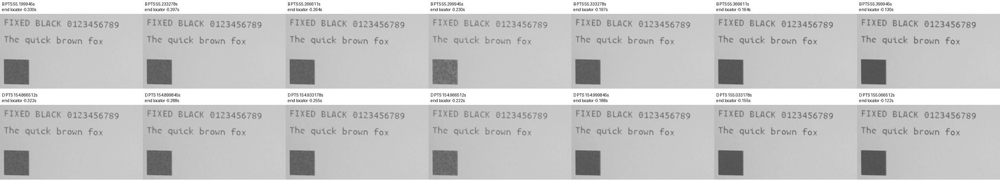
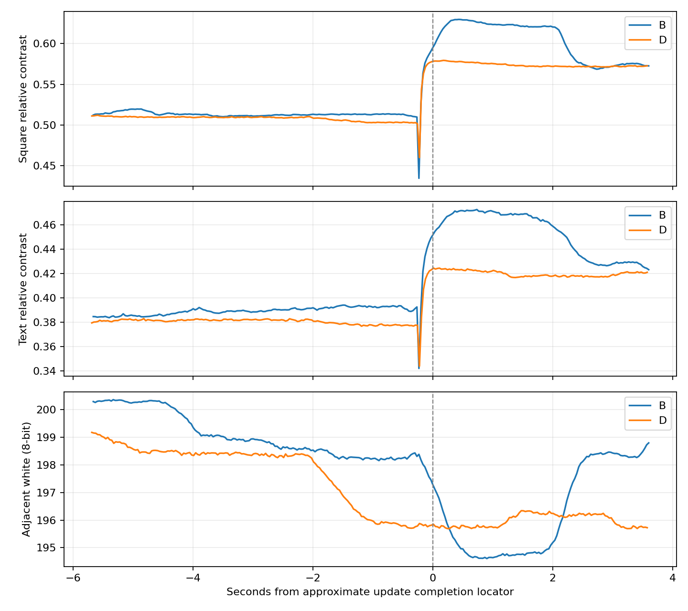

# SSD1677 Candidate B/D：同一Firmware・単発直接比較（2026-10-18）

**判定：D-4（順位判定不能）。** B/Dとも動画の相対コントラストは黒化方向で、Dの単一frameの谷は小さい。ただしBの反射映り込みの可能性と光学変動、Dの測定前の白基準driftがあり、DがBより優れると確定しない。B/D各1回で終了し、試験前のIntegrationへ復元済み。最終表示の濃さ・白背景はユーザーが正常と確認した。

## Git・Firmware・検証

| 項目 | 結果 |
|---|---|
| Branch | `experiment/papermono-black-hold-bd-compare` |
| Worktree | `E:\ESP32\M5PapserMono-SolarOS\.research\black-hold-bd-compare\worktree` |
| 実装Commit / 書込み前HEAD | `26a9b87c1da931dbcc6cf7babff53a9b9cde93c0` / `1567bb78f64af4c849b46320427bc51d17f9cf7f` |
| Trial Application | 3,459,712 B、SHA `0c31b2ac41aaba98d4d1dee1514f3e787d0297ed063d39eabedccbba2a12d1ab` |
| 復元Integration | `391925abff2d261d1d5856711aa0a1f101ac435a` |
| 復元Application SHA | `278665c184653f06a403bd56713e7bf5073131bead0420b3fd2191fa54b12ef6` |
| 製品コードの追加変更 | なし。Host/Build済みの同じApplicationを使用 |
| 既存Worktree保護 | 本日のsnapshotとの比較で、他24個のHEAD/statusと記録対象編集file hashが不変 |

実装・Host・ビルドの詳細は[準備報告](m5paper-mono-black-hold-bd-compare-20261017.md)。専用Driver/Shell 10ケース、独立LUT Python 2件、主要Host 19実行ファイル＋Sketch Python 9件、ESP-IDF 5.5.5／GCC 14.2.0のESP32-S3ビルドはPASS。compiler/CMake warning/error各0。今回はソース・成果物SHAを再照合して使用し、再ビルドしていない。

B=`8F F0`、D=`2F F0`で全110バイトの差分はoffset 0のみ。LUT1〜4、timing/FR、Gate/Source/VCOMは同一。Bは`−15V×2→HOLD×2→＋5V×6`、Dは`HOLD×2→−15V×2→＋5V×6`。新波形を設計せず、通常fastestはBaseline、診断だけで各候補1回。公称Source時間積0でも実効DC・寿命・メーカー適合は未確認。実用Branchへのmerge/push、新Candidate、反復試験なし。

## Flash・Rollback

ユーザーの「Flashに移りましょう」と当日の未保存なし・競合なし・正常画面確認を受け実施。最初はUSB未認識だったが、PC側USBポート変更後にCOM39で復旧した。Windows USB303A:1001／serial `28:84:85:44:79:68`、bootloader接続時のESP32-S3/MAC/16MiB Flashを再確認。他のFlash/capture process該当なし、排他lockを使用。

実行/起動は有効なota_0（offset0x10000、size0x700000）。現物のpartition table・otadataと、読取りApplicationが上記Integration SHAに一致することを確認した。全16MiBとApplicationを新規バックアップした後、Applicationだけを書き、読戻しがTrial SHAと一致。bootloader/partition/NVS/FAT/otadata/PHYは各書込み直前・直後で一致した。

終了後も現物・partition・otadata・現行Trial Applicationを再照合し、本日バックアップしたApplicationだけを復元。読戻しがIntegration SHAと一致し、同じ6保護領域も復元直前・直後で一致。保存文書・bond等を消去/巻戻ししていない。実行中のNVS/FATの通常書込みまで含め、全期間不変だったという意味ではない。

復元後USB Shell、SolarOS4.16.1 writerdeck、実行/起動ota_0 valid、refresh=fastest、既存startupのfastest＋tileを確認。現在はShellが前面で、ユーザー回答は「文字の濃さ・白背景とも正常」。追加のWriter/Sketch/TypeMouse実機回帰は今回は行っていない。保存データ保護とHost回帰の結果を、アプリ実機回帰PASSへ読み替えない。

ローカル退避：`.research/black-hold-bd-compare/archive/20261018-bd-compare/full-flash-before.bin`、`ota0-app-rollback.bin`。全FlashバックアップをGitへ含めていない。将来の復元も現物/slotの再確認後にApplicationだけを使用し、NVS/FATを含む16MiB全体を上書きしない。

証拠：[Flash](evidence/black-hold-bd-results-20261018/flash-summary.json)／[復元](evidence/black-hold-bd-results-20261018/restore-summary.json)／[最終目視](evidence/black-hold-bd-results-20261018/restore-visual.json)／[原記録hash](evidence/black-hold-bd-results-20261018/local-archive-provenance.json)／[他Worktree監査](evidence/black-hold-bd-results-20261018/worktree-audit.json)。

## B/Dの共通条件と実測

同じFirmware・20MHz/tile/Dirty rows-dual、同一画像。追加pacingなし。B→Dの順で各1回。各条件はOTP full白→ユーザー確認→OTP full共通画像→Baseline初回custom→完了5秒後T0→10秒後測定→測定完了2秒後T1→観察後OTP cleanup。途中でT0確認待ちを挟まない。B/D間のcleanupと独立初期化を省略していない。

| 指標 | B | D |
|---|---:|---:|
| 測定0x20 / 0x32 | 1 / 2 | 1 / 2 |
| SPI API時間 | 62.155 ms | 61.724 ms |
| BUSY相当の待機時間 | 51.553 ms | 51.225 ms |
| Driver＋Baseline LUT復帰 | 168.836 ms | 169.497 ms |
| 初回custom完了→T0 | 5000.572 ms | 5000.665 ms |
| 初回custom完了→測定Driver開始 | 10004.900 ms | 10004.998 ms |
| 測定完了→T1 | 2000.836 ms | 2000.171 ms |
| 診断内0x20合計 | 8 | 8 |

各条件の0x20は白OTP2＋画像OTP2＋準備custom1＋候補測定1＋cleanup2＝8、計16。Candidate B=1/D=1、通常UIは別枠。各測定の03/04/2Cは各1、32は2（候補＋Baseline復帰）、20は1。Baseline復帰に追加0x20なし。全phase err=0、BUSY timeout、Driver fault、予想外の反転/汚染、再試行なし。

測定のRAM payloadは各144,000 B、全画面範囲。強制同一画像診断の時間で、通常WriterのDirty小領域転送性能ではない。SPI API時間はAPI呼出し合計、Driver総時間はBaseline LUT復帰を含む。BUSY値は0x20呼出しからpoll待機完了までで立上りエッジ実測ではない。D−Bは総時間＋0.661ms、BUSY−0.328msで、各1回から速度差を断定しない。22=0x0C等の手順はソース/Host比較で一致し、実機はDriverの送信回数・選択波形ログを収集した。logic analyzerや物理LUT readbackはしていない。

| 単調時刻（µs） | LUT送信完了 | 0x20呼出直前 | BUSY待機終了 | Baseline復帰開始 | 復帰終了 |
|---|---:|---:|---:|---:|---:|
| B | 130077439 | 130077644 | 130129197 | 130207033 | 130207171 |
| D | 229731597 | 229731798 | 229783023 | 229861702 | 229861837 |

これらはESP timer時刻で、Serial整形は測定終了後。BUSY開始エッジや各LUT相の光学時刻を測ったものではない。[B計測](evidence/black-hold-bd-results-20261018/B-measurements.json)／[D計測](evidence/black-hold-bd-results-20261018/D-measurements.json)と各[原ログB](evidence/black-hold-bd-results-20261018/B-serial.log)／[D](evidence/black-hold-bd-results-20261018/D-serial.log)。

## 撮影・原動画対応

原本：`C:\Users\takec\Videos\BD\20261018-095642.avi`。1本の連続動画内にB→cleanup→D。作成09:56:42.582 JST、録画180.59秒、更新09:59:43.362。B測定完了ログ09:57:38.112（動画概算55.530秒）、D09:59:17.770（155.188秒）。file名・日時・長さ・共通図形・両測定イベントを照合して対応を確認した。原本は変更せず、解析後のSHAも一致：`e211cae667b4700410e40bc81b5fa81e87ae53a5d5aaad00842499c2c9a0a26d`。[時刻照合](evidence/black-hold-bd-results-20261018/video-time-verification.json)

Insta360 Link、3840×2160/30fps MJPEGを原本で確認。露出/Gain固定、フォーカス**9%**は今回の申告。前回の19%を流用していない。WBの今回の数値は未提示、controller状態のreadbackなし。自然光は遮断できないとの回答、パネル温度未測定。試験順の履歴/温度差は残る。

ユーザー追記：「Bの途中で撮影者の反射映り込みの可能性あり、Dは安定して撮影」。Dの安定という目視申告と、動画での白基準driftを分けて評価した。反射の正確な時刻と寄与率は確定できない。[申告記録](evidence/black-hold-bd-results-20261018/optical-observation.json)

## ROI・時間同期・取得品質

現画角は前回A/Dと異なるため、新しい共通ROIをT0プレビューから**数値計算前**に選択。B/D間の位置/倍率一致をoverlayで確認した。厳密なsubpixel registrationはしていない。元解像度の黒四角 `[570,720,720,870]`、近傍白 `[840,720,990,870]`、固定2行文字 `[525,315,1560,585]`、文字白 `[540,594,1560,648]`。各T0の黒threshold0.65×近傍白で文字maskを固定（B9328画素/D8712画素）、T1で選び直さない。`C=(白−黒)/白`。T0/T1後0/0.5/1秒の3標本のC中央値を主値とする。カメラの8bit相対値で、反射率の厳密な測光ではない。

Serial受信とfile作成日時からの動画位置は概算。1本の動画で時刻原点の差は減ったが、カメラ/USBの校正同期はない。光学谷は概算更新完了より約0.23秒前（B）/0.22秒前（D）にある。命令送信やLUT相へ厳密に対応づけない。更新前5秒の全native値を残し、drift評価では更新を含み得る末尾を除き「概算Driver開始−5秒〜概算完了−0.5秒」を使った。局所直前Cは前回と同じ概算完了−0.75〜−0.5秒の中央値。

clipは解析した全native frameで黒/白とも0%。ただしPTSに66.667msの間隔がB/D各1箇所ある。B51.333282→51.399949秒（概算完了の約4.2秒前）、D152.033181→152.099848秒（約3.1秒前）。更新近傍の7連続frameにはこのgapはない。カメラ内部の欠落/重複露光までは未確認。30fps/rolling shutterにより短い谷の深さ・持続時間は確定できず、単一frame最小と3frame中央値を併記する。frameを独立反復と数えない。

## 光学結果（外乱を含む参考値）

| ROI | B T0 | B T1 | B ΔC | D T0 | D T1 | D ΔC |
|---|---:|---:|---:|---:|---:|---:|
| 黒四角 | 0.51505 | 0.57459 | +5.95 pp | 0.50994 | 0.57205 | +6.21 pp |
| 固定文字 | 0.38693 | 0.43299 | +4.61 pp | 0.38212 | 0.41804 | +3.59 pp |

T0のD−Bは四角−0.51pp、文字−0.48pp。最終ΔCのD−Bは四角＋0.26pp、文字−1.01ppで、両ROIが一貫してD優位ではない。両候補に黒化方向の映像変化はあるが、以下の外乱を含むため波形固有の効果量とは扱わない。ユーザー目視は両方「濃さほぼ不変・背景正常・目立つちらつきなし」。

| 条件/ROI | 局所直前C | raw谷C | 局所→raw低下pp | 3frame谷C | 局所→3frame低下pp | 谷→T1回復pp（raw/3frame） | T0→谷低下pp（raw/3frame） |
|---|---:|---:|---:|---:|---:|---:|---:|
| B 黒四角 | 0.51332 | 0.43452 | 7.88 | 0.50980 | 0.35 | 14.01 / 6.48 | 8.05 / 0.52 |
| D 黒四角 | 0.50324 | 0.46002 | 4.32 | 0.50162 | 0.16 | 11.20 / 7.04 | 4.99 / 0.83 |
| B 固定文字 | 0.39314 | 0.34203 | 5.11 | 0.38911 | 0.40 | 9.10 / 4.39 | 4.49 / -0.22 |
| D 固定文字 | 0.37769 | 0.34392 | 3.38 | 0.37720 | 0.05 | 7.41 / 4.08 | 3.82 / 0.49 |

rawではDの局所低下が小さい（四角B7.88→D4.32pp、文字5.11→3.38pp）。ただし3frame中央値では両候補の谷が大幅に薄まり、窓内の最低値が必ずしも谷の同一frameに対応しない。短い過渡の定量はsampling位相に敏感で、「白化なし」や有意な軽減と断定しない。

## 測定前の安定性・反射の影響

| 条件/ROI | 白の初期→直前変化 | 白range | 黒の初期→直前変化 | Cの初期→直前変化pp | C range pp |
|---|---:|---:|---:|---:|---:|
| B 黒四角 | -1.03% | 1.09% | +0.06% | -0.53 | 0.95 |
| D 黒四角 | -1.33% | 1.51% | +0.04% | -0.68 | 0.77 |
| B 固定文字 | -1.11% | 1.17% | -2.37% | +0.78 | 0.97 |
| D 固定文字 | -1.16% | 1.29% | -0.49% | -0.44 | 0.62 |

上表は同期不確かな末尾を除いた概算測定前区間の、初期0.5秒と終端0.5秒の中央値比較。Bは白が約1.0〜1.1%低下し、文字Cは逆に＋0.78pp、四角Cは−0.53pp。Dでも白が約1.2〜1.3%低下し、Cが−0.44〜−0.68pp。完全に安定した共通光学条件とは扱えない。

Bの更新近傍の前後窓では白が四角−1.39%/文字−1.49%変化する一方、Dは−0.08%/−0.06%。Bは更新後から概算＋2秒付近で白/黒コントラストの大きな戻りもあり、撮影者の反射の可能性という申告と整合する光学外乱がある。ただし反射だけが原因と特定できず、パネル応答との寄与分離もできない。近傍白で割るだけでは非一様な反射・影を除去できない。Dのraw谷が小さいという見かけを、そのままB/D波形の差と結論づけない。

全値：[ROI/native時系列](evidence/black-hold-bd-results-20261018/roi-results.json)／[局所谷・安定性・PTS/clip](evidence/black-hold-bd-results-20261018/stability-local-metrics.json)／[B ROI](evidence/black-hold-bd-results-20261018/B_roi-overlay.png)／[D ROI](evidence/black-hold-bd-results-20261018/D_roi-overlay.png)。

## 最終判断と停止位置

**D-4：比較条件に光学外乱があり順位判定不能。** D-5に相当する実機異常はなく、Driver/送信回数/時刻/cleanup/復元は正常。参考所見は「両方黒化方向、Dの単一frameの過渡谷は小さい傾向」だが、D-1認定には不足する。D-2/B優位とも判定しない。B/D両者を候補として保持し、短期反復Trialの優先順位は保留する。

今回の結果だけで実用統合は推奨確定しない。実効DC、長期安全性、寿命、反復安定性、通常アプリでの黒保持は未確認。必要なら次の別依頼で反射/自然光と時間同期を改善した比較条件を検討する。比較不成立を理由とする自動再実行はしない。元動画とバックアップを保持し、現在の実機はTrialではなく元のIntegrationで終了した。
