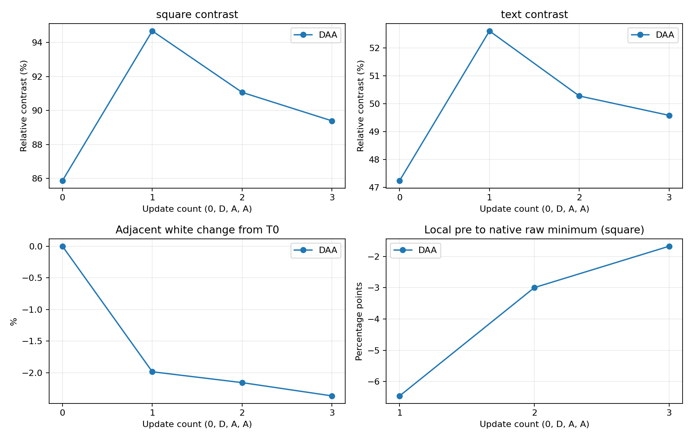
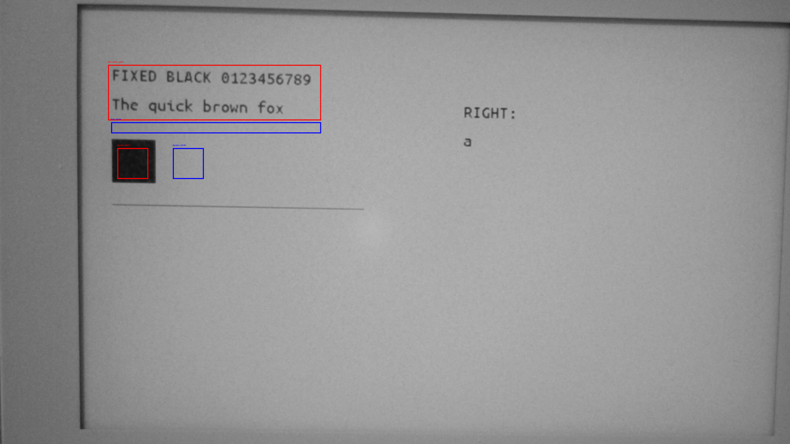
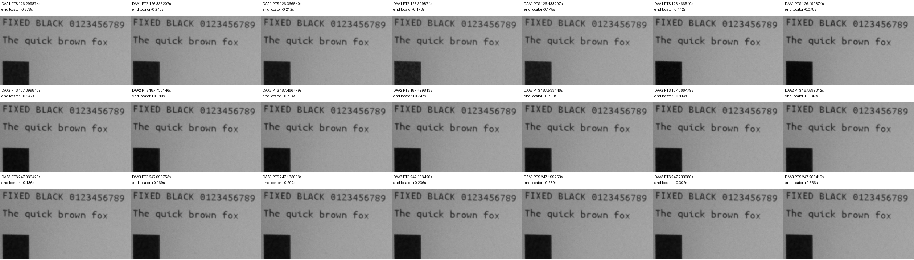

# SSD1677 D→A→A：制限付き反復Trial結果（2026-10-18）

**判定：P-2「初回Dで黒化するが、通常A更新で薄まる」を今回の相対映像解析が支持。** D直後の黒四角94.69%／固定文字52.61%から、Aを2回実行後は89.39%／49.58%へ低下した。最重要指標のdC2・dC3は両ROIとも負だった。C3はC0を上回っているが、それだけで「初回Dだけで十分」とは判断しない。

ユーザー目視は全段階で「濃さほぼ不変・背景正常」、終了時も「T1以降の濃さほぼ不変・目立つちらつきなし」。肉眼で差を確認したという結果ではない。単一セッション・未校正の8bit映像であり、自然光・反射・温度未測定・30fpsの限界が残る。実効DCバランス、長期寿命、実用適用頻度は未確認。

測定はD→A→Aの3回のみ、Dは1回。途中にOTPや初期画像の再描画を挟まず、終了後に予定のOTP cleanupを1回実施した。試験前IntegrationへApplication-only復元し、読戻し一致・保護領域一致・USB Shell/Launcher起動・ユーザーの正常表示確認まで完了した。

## Git・実装・検証

| 項目 | 結果 |
|---|---|
| Branch | `experiment/papermono-black-hold-d-prime-aa` |
| Worktree | `E:\ESP32\M5PapserMono-SolarOS\.research\black-hold-d-prime-aa\worktree` |
| 基点Commit | `42aec97cb19db5b920b3d29a8923e3a2e2724737` |
| 実装Commit | `47921bc7d963d8ddad1a6dfd77f3a50fbeb22c67` |
| Flash時HEAD | `e805a3582f72af4aad8b9ab5bfad0b24e95e1dc1`（準備報告・Host fixture依存追加。製品コード/Binaryは実装Commitと同じ） |
| Trial Application | 3,459,312 B、SHA-256 `3e7f89ddaa64d3adb946ca0f1e13a3b48ae28fe03c875771f8ca914b6fd6649d` |
| Board / Flavor / Layout | m5paper_mono / writerdeck / ota |
| Host | 新Driver・新Shell20ケース、旧B/D Driver・Shell10ケース、旧repeat3 Driver・Shell17ケース、Waveform・独立LUT Python2件PASS。主要Host19実行ファイル＋Sketch Python9件PASS |
| Build | ESP-IDF5.5.5 / GCC14.2.0、ESP32-S3 PASS、約293秒、Compiler/CMake warning/error各0 |
| 実機段階の製品コード変更 | なし。凍結済みApplicationをSHA照合して使用 |

実装差分・全フラグ・変更11ファイルと既存機構の再利用は[準備報告](m5paper-mono-black-hold-d-prime-aa-20261018.md)を参照。主な変更箇所はDriverの固定順序予約・回数ガード（`src/drivers/epd_ssd1677.c:1040`以降）、既存Shell診断のD/A/A固定・60秒スケジュール（`src/shell/solar_os_shell_black_hold_single.inc:252`以降）、専用コマンド登録（`src/shell/solar_os_shell_commands.c:656`）、専用Hostテスト2ファイル。通常Driver更新本体、LUT配列・電圧・Timing/FR、Dirty rows-dual、Writer/Sketch/TypeMouse、起動設定は変更していない。

Host/Build後に一度停止し、ユーザーの「Flash準備できました」と接続・未保存なし・競合なし・表示正常の確認後に実機へ進んだ。既存Worktreeは最終監査で別途確認し、実用Branchへのmerge/pushは行わない。

## Flash・復元・最終Firmware

COM39のUSB識別、ESP32-S3、MAC `28:84:85:44:79:68`、Flash ID `0x184046`・16MiB、実Partition、otadata CRC/選択、実行/起動`ota_0`・offset`0x10000`・容量`0x700000`を再確認した。現行Applicationを新規全16MiBバックアップから照合し、既知Integrationと一致した。

Trialの書込み先はApplication領域だけ。Bootloader・Partition table・NVS・otadata・PHY・FATの6領域は書込み直前/直後で一致した。Trial読戻しSHAは上表と一致。試験後もslot・セッション・競合を確認し、新規保存した元Applicationだけを復元した。復元時点の6保護領域も直前/直後で一致し、Applicationの読戻しは保存binとバイト一致した。

| 最終状態 | 結果 |
|---|---|
| 復元Integration | `391925abff2d261d1d5856711aa0a1f101ac435a` |
| Application SHA-256 | `278665c184653f06a403bd56713e7bf5073131bead0420b3fd2191fa54b12ef6` |
| 起動・実行 | ota_0、SolarOS4.16.1 / writerdeck、USB Shell応答・Launcher active |
| startup | 既存のUSB Shell作成、`refresh=fastest`・`fastest-path=tile`を維持 |
| ユーザー最終確認 | 「Launcher（またはShell）の表示は正常」 |

試験開始時と復元時のNVS/FATのhashは異なるが、各Flash操作の直前/直後では一致している。試験中に変化した内容の内訳は未解析であり、「全試験期間でNVS/FATが不変」とは報告しない。全Flashを書き戻して履歴・ユーザーデータを巻き戻さず、復元直前の状態を保持した。BLE再ペアリング、保存文書の編集・保存、追加のWriter/Sketch/TypeMouse実機回帰は行っていない。これらのHost回帰は準備時PASS。

**最終実機は元Integration。Candidate Dは常用状態に残していない。** ローカル復元用バックアップは`.research/black-hold-d-prime-aa/archive/20261018-d-prime-aa/`の`ota0-app-rollback.bin`と`full-flash-before.bin`。復元には同じフォルダを参照する`restore_single_guarded.py`を使用済み。再操作が必要な場合は改めて実機・slotを確認する。bondを含むraw Flash、Firmware、元動画はGitへ追加しない。

## 更新回数・LUT・時間

白・T0・T1・T2・T3の各gateで、その段階に対応するユーザー回答を受けた後に1個の`g`だけを送った。予約・測定成功は3、失敗/cancel/timeout/再試行0。Dを再適用せず、4回目を実機で試していない。

| 工程 | 0x20発行回数 |
|---|---:|
| OTP full白 | 2 |
| OTP full共通画像 | 2 |
| Baseline初回custom（測定外） | 1 |
| D→A→A測定 | 3 |
| 予定OTP cleanup | 2 |
| **診断内合計** | **10** |

通常UI・boot更新はこの集計外。測定の合計は3回、うちDは1回である。SPI実効20MHz、fastest＋tile、Dirty rows-dualを使用した。同一48,000B画像の全RAM強制更新なので、Writerの局所Dirty性能とは区別する。

| 更新 | LUT0要求 | RAM payload B | RAM SPI API ms | BUSY待機相当 ms | Driver＋LUT復帰総 ms | 0x20 |
|---|---|---:|---:|---:|---:|---:|
| 1：D | 2F F0 | 144,000 | 61.694 | 51.601 | 169.453 | 1 |
| 2：A | 00 00 | 144,000 | 62.260 | 51.489 | 169.233 | 1 |
| 3：A | 00 00 | 144,000 | 61.923 | 51.466 | 168.206 | 1 |

各測定で`03/04/2C`各1回・`32`2回・`20`1回。`BH lut`は1回目`2FF0`、2/3回目`0000`、全回で`lut_send_ok=1 baseline_restore_ok=1 physical_readback=0`だった。Baseline再送には追加の`0x20`なし。Hostでは全LUT payloadと順序を検証したが、実機は送信成功ログに基づく確認であり、物理LUT readbackではない。

平均は総168.964ms／BUSY51.519ms／RAM SPI API61.959ms。BUSYはAPI待機相当で実edge計測ではなく、SPIはAPI累計で単純なwire時間ではない。総時間は専用診断のLUT復帰を含み、入力→肉眼表示完了の遅延ではない。OTPのBH RAM欄0は計測欄未設定であり、RAM転送なしを意味しない。OTPはBH totalと既存OTP各phaseログを使用した。

| 区間 | 前回完了→次回Driver開始 | 完了→Tn |
|---|---:|---:|
| 初回Baseline準備→D | 60.005581s | 2.000814s |
| D→A | 60.005863s | 2.000718s |
| A→A | 60.005762s | 2.000750s |

60秒目標からの超過は約5.6〜5.9ms。今回は操作者承認が全回目標前に届き、実測間隔を揃えられた。各回の承認待ちを省略して時刻だけで自動継続したわけではない。

## 元動画・解析方式・品質確認

原本は`C:\Users\takec\Videos\DAA\20261018-164317.avi`、2,139,321,728 B、SHA-256 `3577d2097ed25f497454db494e1ec36a05ae2cc5ea561a628de14e8722cde0e4`。ファイル名と作成時刻16:43:17.749→最終更新16:47:58.491（JST）、duration280.590秒、3840×2160・nominal30fpsを確認した。作成〜最終更新とdurationの差は約0.151秒。

USB受信時刻はD終了16:45:24.328、A2終了16:46:24.502、A3終了16:47:24.680。原本の概略位置はT0=71.402秒、T1=128.573秒、T2=188.751秒、T3=248.925秒で、録画範囲・順序・約60秒間隔・映像内の変化に整合した。別動画との取り違えは確認されない。受信時刻−原本作成時刻は校正済みカメラ同期ではなく、厳密な駆動phaseとの対応付けはできない。

ユーザー申告は前回と同じ固定設定：Insta360 Link、4K30、露出/Gain・WB・focus固定、本体/カメラ固定（前回focus9%、今回は同設定との申告）。WB等の数値は今回再照合していない。自然光は前回遮断不可で、今回新たな遮断成功の申告はない。温度未測定。

抽出T0/T3と接触シートを目視確認してから既存ROIを凍結した。黒四角`[570,720,720,870]`／近傍白`[840,720,990,870]`、固定文字patch`[525,315,1560,585]`／白`[540,594,1560,648]`。文字maskはT0で白×0.65未満の23,616画素に固定した。各Tnの0/0.5/1秒後の3frame中央値をCとして使用し、更新前後は各263 native frameを解析した。時間相関したframeを独立した実験反復とは扱わない。

## C0〜C3・ΔC・最重要dC

C=`(近傍白−黒)/近傍白`。表のCはC×100（%）、ΔCとdCはpercentage point（pp）。反射率・校正測光値ではない。

| 段階 | 波形 | 黒四角C | 文字C | 黒四角ΔC | 文字ΔC | 黒四角dC | 文字dC |
|---|---|---:|---:|---:|---:|---:|---:|
| C0 | 共通初期化 | 85.87 | 47.24 | 0 | 0 | — | — |
| C1 | D | 94.69 | 52.61 | +8.81 | +5.37 | +8.81 | +5.37 |
| C2 | A | 91.07 | 50.27 | +5.20 | +3.03 | **−3.62** | **−2.33** |
| C3 | A | 89.39 | 49.58 | +3.52 | +2.34 | **−1.68** | **−0.69** |

初回Dの黒化は再現したが、Aへ戻すと2回とも低下した。C3>C0は初回黒化の一部が残っていることを示すだけで、Aによる薄まりが止まったことを示さない。H2を支持し、今回条件でのH1「通常Aでも黒化を維持」を支持しない。

近傍白のT0比は黒四角側0／−1.98／−2.16／−2.37%、文字側0／−1.78／−1.86／−2.20%。長い区間の照明・反射変動を完全には除外できない。一方、各更新直前約4.7秒の白rangeは0.25〜0.43%、更新をまたぐ短い窓の白変動は0.04〜0.31%。A2/A3の局所前後C変化も黒四角−2.79／−1.57pp、文字−2.30／−1.13ppで低下方向だった。単に長時間の白基準変動だけを比較した結果ではないが、局所反射等の残余誤差はある。

感度確認でも同じ傾向：文字mask閾値0.55/0.65/0.75のdC2は−2.41/−2.33/−2.12pp、dC3は−0.69/−0.69/−0.69pp。黒四角を20px内側へ縮めるとdC2/3は−3.53/−1.74pp。効果が大きいROIへ選び直していない。

## 更新中の変化・目視

更新終了locatorの±1秒から求めた最小Cを、局所直前中央値と比較した。

| 更新 | 黒四角raw最小差 pp | 黒四角median3最小差 pp | 文字raw最小差 pp | 文字median3最小差 pp |
|---|---:|---:|---:|---:|
| D1 | −6.45 | −3.24 | −2.36 | −2.10 |
| A2 | −3.00 | −2.95 | −2.44 | −2.41 |
| A3 | −1.68 | −1.62 | −1.24 | −1.19 |

Dの接触シートには短い薄まり後の黒化が見える。Aの最小値はその後の薄い安定状態も含むので、すべてを「一時白化して回復」と解釈しない。30fpsで2frame等の波形phaseを分離したとは主張しない。

D近傍に66.667msのnative PTS gapが1か所（終了概略−0.545〜−0.478秒）、A近傍は各263frameに50ms超gapなし。camera内の露出重複は未確認。クリップは最大でも黒四角の0.00444%で、ほかは0%。黒つぶれ・白飛びが今回の主要因という証拠はない。明瞭な大きな撮影者影は確認されなかったが、自然光・微弱な反射変動まで否定しない。

ユーザーはD後もA後も「濃さほぼ不変」、背景正常、終了時は「目立つちらつきなし」と回答。光学解析の小差と目視結果を分けて残す。表示反転・強い残像・BUSY timeout・LUT復帰失敗・更新失敗は確認されなかった。

## 前回との関係・次の設計判断

前回AAAではdC2/3が黒四角−0.91/−1.18pp、文字−0.61/−0.50pp。DDDでは+1.16/+0.32pp、+1.31/+0.43ppだった。今回DAAはD後のAで低下し、Dを繰り返した前回と方向が異なる。ただし前回は開始C・照明・更新間隔が異なる別セッションで、差の大きさを同条件比較・統計的優劣として扱わない。

| 将来案 | 今回結果から言えること |
|---|---|
| 毎回D | 前回短期DDDの保持結果はあるが、過渡薄まり・DC/寿命未確認。常用採用しない |
| 数回に1回D | D後もAで低下するため検討候補。ただし今回の2回だけで周期を決められない |
| 品質低下時だけD | 不要駆動を減らす候補だが、実用的な品質判定閾値と再適用の検証が別途必要 |
| 初回だけD | 今回のA2/A3低下により、持続保持策として十分とは支持されない |

今回は**P-2**で終了する。D再適用の必要性の仮説を支持するが、適用頻度・長期安全性は決めない。新Candidate、4回目、6回Trial、Writer常用統合、実用Branchへのmerge/pushへ自動移行していない。

## 証拠

[実機計測JSON](evidence/black-hold-d-prime-aa-results-20261018/DAA-measurements.json)、[USB rawログ](evidence/black-hold-d-prime-aa-results-20261018/daa-usb.log)、[Flash監査](evidence/black-hold-d-prime-aa-results-20261018/flash-summary.json)、[復元監査](evidence/black-hold-d-prime-aa-results-20261018/final-deployment-audit.json)、[原本照合](evidence/black-hold-d-prime-aa-results-20261018/video-sources.json)、[抽出時刻](evidence/black-hold-d-prime-aa-results-20261018/extraction.json)、[ROI結果](evidence/black-hold-d-prime-aa-results-20261018/DAA-roi.json)、[感度・PTS](evidence/black-hold-d-prime-aa-results-20261018/robustness.json)、[解析スクリプト](evidence/black-hold-d-prime-aa-results-20261018/analyze_video_roi.py)。

