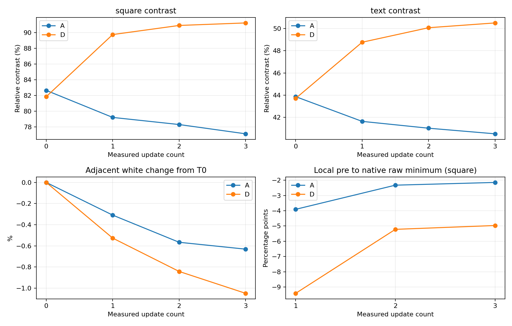

# SSD1677 Candidate D：制限付き3回反復Trial結果（2026-10-18）

**判定：R-1（今回の短期条件でDの固定黒保持・黒化を支持）。** 元動画の同一ROIでは、Aは3回の反復で薄まり、Dは初回で黒化し、2〜3回目も黒さを保持した。ただしDの短い過渡白化は残る。ユーザー目視はA/Dとも「濃さほぼ不変・差なし」であり、肉眼で改善を確認したとは報告しない。

各回を確認してA/D各3回で終了。4回目・6回Trial・新Candidate・実用統合へ移行していない。試験前のIntegrationへApplication-only復元し、読戻し一致・保護領域一致・USB Shell/Launcher起動・ユーザーの正常表示確認まで完了した。

## Git・実装・ビルド

| 項目 | 結果 |
|---|---|
| Branch | `experiment/papermono-black-hold-d-repeat3` |
| Worktree | `E:\ESP32\M5PapserMono-SolarOS\.research\black-hold-d-repeat3\worktree` |
| 基点 | `a65d8ec83b5ae2bff5ace40e8032f047657a0ffd`（既存B/D成果） |
| 実装Commit／実機書込み前HEAD | `e1935704df27d6d0e7e5cf25c7d63133c8c74faa`／`f128350fb662e53ce54402645bced731dae6eeac` |
| Trial Application | 3,460,144 B、SHA `26acd03ca96f608cf3602466c0efd239cdb6f17ac475e317e124c90904af8e4a` |
| 復元Integration | `391925abff2d261d1d5856711aa0a1f101ac435a`、SHA `278665c184653f06a403bd56713e7bf5073131bead0420b3fd2191fa54b12ef6` |
| Host / Build | 新Driver・Shell17ケース、既存B/D Driver・Shell10ケース、Waveform、LUT Python2、主要Host19実行ファイル＋Sketch Python9件PASS。ESP-IDF5.5.5/GCC14.2.0のESP32-S3ビルドPASS、Compiler/CMake warning/error各0 |
| 今回の追加製品コード変更 | なし。Host/Build済みの同じApplicationをSHA照合して使用 |
| 他Worktree | 既存25個のHEAD/Branch/statusと記録対象編集hashが不変。元Worktreeの未追跡`.vscode/`を維持 |

変更ファイル・フラグ・回数ガード・LUT検証の詳細は[準備報告](m5paper-mono-black-hold-d-repeat3-20261018.md)。既存B/Dの画像、claim、submission、LUT復帰、OTP、計測・光学処理を再利用した。Driverの通常更新本体、LUT配列、電圧、Timing/FR、Dirty rows-dual、Writer/Sketch/TypeMouseは基点から変更していない。

AはBaseline LUT0=`00 00`、Dは既存LUT0=`2F F0`。DはHOLD×2F→−15V×2F→＋5V×6F、計10F。公称Source時間積0は実効DC、VCOM/キックバック/残留電荷、寿命、メーカー適合の証明ではない。物理LUT・電圧のReadbackや電気測定も行っていない。

## Flash・復元と最終Firmware

COM39、ESP32-S3、MAC `28:84:85:44:79:68`、16MiB Flash、partition table、実行/起動`ota_0`・offset`0x10000`・7MiBを現物確認した。Writer/Sketch未保存なしと実機競合なしをユーザーが確認。初めはShellのままという申告だったが、USBではShell activeで、サスペンドではなくLauncherが閉じられた状態と判明した。黒さ・白背景の正常確認後に書き込んだ。

新規全16MiBバックアップとApplicationを保存し、現行Applicationが既知Integrationと一致すること、otadata CRC/選択slot、Trial SHAを確認してApplicationだけを書き込んだ。読戻しSHAは上表と一致。Bootloader、partition table、NVS、otadata、PHY、FATの6領域はFlash直前・直後で一致。

終了後もslotと無編集状態を確認し、保存Applicationだけを復元。復元時点の6保護領域は復元直前・直後で一致し、Application読戻しも保存binと一致した。NVS/FATのhashは試験開始時と復元時で異なるが、試験中の内訳は未解析。試験中の履歴・設定等を過去へ巻き戻さず、復元直前のデータを保持した。「全試験期間を通じNVS/FATが一切変化していない」という意味ではない。

USB Shell・Launcher起動、`/.shell/startup`のfastest＋tile維持を確認。最後にユーザーが「Launcher（またはShell）の表示は正常」と回答。BLE再ペアリング、保存文書の上書き、実用Branchへのmerge/pushは行っていない。Writer/Sketch/TypeMouseの追加実機回帰は行わず、更新回数を増やしていない。これらのHost回帰は準備時PASS。

**最終実機は試験前のIntegration。D Trialを常用状態に残していない。** 復元参照・全Flash・保護領域snapshotはローカルの`.research/black-hold-d-repeat3/archive/20261018-d-repeat3/`に保持。bondを含むrawバックアップ、Firmware、元動画はGitへ追加していない。

## 更新回数・時間

T0/T1/T2ごとにユーザー確認後、1回分の`g`だけを送った。A/Dとも起動中予約3・成功3、失敗/cancel/timeout/復帰失敗0。Baseline復帰で追加`0x20`なし。各測定で`03/04/2C`各1回、`32`2回、`20`1回。実機で4回目の拒否を試すための操作はせず、Hostで検証した。

| 工程／条件 | Aの0x20 | Dの0x20 |
|---|---:|---:|
| OTP白 | 2 | 2 |
| OTP共通画像 | 2 | 2 |
| Baseline初回custom（測定に含めない） | 1 | 1 |
| 測定3回 | 3 | 3 |
| OTP cleanup | 2 | 2 |
| 合計 | **10** | **10** |

診断内合計20回、うち測定6回。通常Shell/Launcher・boot表示は別で、全稼働時間の物理更新総数を20回とするものではない。SPI実効20MHz、fastest＋tile、rows-dual。全RAM同一画像の強制更新であり、Writerの局所Dirty時の性能とは別。

| 更新 | RAM payload B | RAM SPI API ms | BUSY待機相当 ms | Driver＋LUT復帰総 ms | 0x20 | 0x32 | error |
|---|---:|---:|---:|---:|---:|---:|---:|
| A1 | 144,000 | 61.590 | 51.201 | 169.244 | 1 | 2 | 0 |
| A2 | 144,000 | 62.368 | 51.516 | 169.710 | 1 | 2 | 0 |
| A3 | 144,000 | 61.797 | 51.530 | 169.371 | 1 | 2 | 0 |
| D1 | 144,000 | 61.787 | 51.603 | 169.876 | 1 | 2 | 0 |
| D2 | 144,000 | 61.471 | 51.737 | 169.370 | 1 | 2 | 0 |
| D3 | 144,000 | 61.773 | 51.513 | 169.636 | 1 | 2 | 0 |

平均：A総169.442ms／BUSY51.416ms／SPI61.918ms、D総169.627ms／BUSY51.618ms／SPI61.677ms。各3回なので速度の統計的同等性を主張しない。SPIはDriverのRAM API計測累計で、単純なwire転送時間ではない。BUSYはAPI待機相当で立上りedgeや肉眼の画素変化開始ではない。

| 条件 | 準備完了→測定1開始 s | 測定1→2開始間隔 s | 測定2→3開始間隔 s |
|---|---:|---:|---:|
| A | 47.027 | 57.256 | 32.336 |
| D | 50.606 | 38.616 | 38.636 |

各操作受領→Driver開始は約5.006秒、各完了→Tnは約2.000秒。表のとおり実際の更新間隔は一致しておらず、完全同条件とは扱わない。初期化・画像・波形比較以外の設定は共通だが、操作者確認の待機が入っている。

準備時の長い`BH phase=prepare-baseline`だけ末尾RAM欄が文字数上限で切れ、次のtraceと結合した。rawログを保全し、完全な`REF ram_bytes=192000`と4×48,000Bのwriteログから準備payloadを監査した。6測定のBH/REF payloadはすべて144,000Bで一致。測定のcount・time・traceは完全。OTPのBH `ram_bytes=0`はその計測欄が未設定で、実RAM転送なしという意味ではない。試験中にFirmwareを変更・再試験していない。

## 元動画・測定方式

| 条件 | 元動画 | 作成→最終更新（JST） | 実duration |
|---|---|---|---:|
| A | `C:\Users\takec\Videos\20261018-130142.avi` | 13:01:42.957→13:06:15.100 | 271.950s |
| D | `C:\Users\takec\Videos\20261018-130712.avi` | 13:07:12.416→13:10:46.411 | 213.800s |

ファイル名・作成/終了時刻・duration・USB receipt・全T0〜T3がA→D順に整合し、取り違えは確認されなかった。作成〜最終更新とdurationの差はA約0.193秒、D約0.195秒。両方3840×2160、nominal30fps。原本SHAは[video-sources.json](evidence/black-hold-d-repeat3-results-20261018/video-sources.json)。元動画を変更せず抽出した。

Insta360 Link、ユーザー申告は前回と同じ固定設定（4K30、露出/Gain・WB・focus固定、focus9%、本体/カメラ固定）。WB等の数値は今回再照合なし。自然光は前回遮断不可で、今回新たな遮断成功の申告はない。温度未測定。

USB receipt wallclock−PC原本作成時刻を概略locatorとし、各T0〜T3で0/0.5/1秒後の3frameを抽出、中央値を使用。各更新前後はnative PTSで263frameずつ解析した。カメラ同期は校正しておらず、厳密なLUT phaseへの対応付けはできない。安定frameと過渡接触シートで表示内容・位置を目視照合した。

前回B/Dの固定ROIを、今回のA/D T0で同じ画角・文字・四角との対応を目視確認してから凍結。文字maskは各動画T0の近傍白×0.65未満で固定（A21,943画素、D21,858画素）。各更新でmaskやROIを選び直していない。Cは8bit映像の`(白−黒)/白`で、校正反射率・厳密測光ではない。frameは時間相関しており、独立した反復試行数ではない。

## 主評価：固定黒のC0〜C3

表はC×100（%）、変化量はpercentage point（pp）。黒四角と文字を分け、各条件のC0を基準にした。

| 更新回数 | A黒四角 C% | D黒四角 C% | A固定文字 C% | D固定文字 C% |
|---|---:|---:|---:|---:|
| 0 | 82.65 | 81.85 | 43.87 | 43.71 |
| 1 | 79.21 | 89.75 | 41.64 | 48.76 |
| 2 | 78.31 | 90.91 | 41.03 | 50.07 |
| 3 | 77.13 | 91.23 | 40.53 | 50.50 |

| 回数 | A四角 ΔC pp | D四角 ΔC pp | 四角 Δ改善 pp | A文字 ΔC pp | D文字 ΔC pp | 文字 Δ改善 pp |
|---|---:|---:|---:|---:|---:|---:|
| 1 | -3.44 | +7.90 | +11.34 | -2.22 | +5.05 | +7.27 |
| 2 | -4.35 | +9.06 | +13.41 | -2.84 | +6.36 | +9.19 |
| 3 | -5.53 | +9.38 | +14.91 | -3.34 | +6.79 | +10.13 |

`ΔC_n=C_n−C0`、`Δ改善_n=ΔC_D,n−ΔC_A,n`。

| 更新 | A四角 dC pp | D四角 dC pp | A文字 dC pp | D文字 dC pp |
|---|---:|---:|---:|---:|
| 1 | -3.44 | +7.90 | -2.22 | +5.05 |
| 2 | -0.91 | +1.16 | -0.61 | +1.31 |
| 3 | -1.18 | +0.32 | -0.50 | +0.43 |

`dC_n=C_n−C_(n−1)`。Dは初回の黒化が大半で、以後の増分は小さくなる。3回目の増分は更新前のframe変動幅とも同程度なので、正確な飽和量は決められない。一方、2〜3回目で元の黒さ以下へ戻る・薄まりへ転じる現象はこの測定では認めなかった。3回投与の保持を支持するが、「初回Dだけでも保持されたか」との分離比較はしていない。

T0のD−Aは四角−0.80pp、文字−0.15ppで、初期値が完全一致とはしない。文字mask閾値を0.55/0.75に変えた補助確認でもAのC3変化−2.95〜−3.57pp、D＋6.30〜＋6.79ppで方向不変。黒四角ROIをさらに20px内側にしてもA−5.46pp、D＋9.28ppだった。結果に合わせたROI再選択はしていない。

## 過渡的な薄まり・外乱・目視

局所直前は概略終了locatorの−0.75〜−0.5秒の中央値、raw/median3最小はlocator±1秒内。値は「最小C−局所直前C」（負で一時的低下）。Aでは低下後の保持低下も最小に含まれ、Dの短い白化pulseと同じ現象の振幅とは断定しない。

| 更新 | 四角raw谷 pp | 四角median3谷 pp | 文字raw谷 pp | 文字median3谷 pp |
|---|---:|---:|---:|---:|
| A1 | -3.91 | -3.90 | -2.81 | -2.77 |
| A2 | -2.32 | -2.25 | -1.44 | -1.43 |
| A3 | -2.14 | -2.13 | -1.27 | -1.26 |
| D1 | -9.42 | -0.05 | -4.57 | -0.21 |
| D2 | -5.22 | -2.18 | -2.59 | -1.41 |
| D3 | -4.97 | -1.41 | -2.44 | -1.51 |

Dは1〜数frameの一時白化後に黒化している。四角raw谷は初回最大で後続2回に増大する傾向はないが、median3谷は単調でない。33ms刻みの撮影位相・平均露光の影響があり、厳密な最大白化量やLUT内の位相・継続時間は未確定。過渡白化の問題が解消したとはしない。

ユーザー目視はA/D各T1/T2/T3で「濃さほぼ不変・背景正常」、最後はA/D差なし・目立つちらつきなし。動画補助測定と別にそのまま記録する。短い白化は目視では目立たなかったという範囲で、動画上のpulseの許容性・長期使用感まで確認したものではない。

白四角近傍はT0→T3でA−0.63%、D−1.05%、文字近傍A−0.55%、D−1.04%。自然光等の全期間driftが残る。各更新前のguarded区間（開始−5秒〜概略終了−0.5秒）の白rangeはおおむね0.25〜0.47%、C rangeは最大約0.81pp。選択した更新前後と接触シートに明瞭な人物反射の割込みは確認しなかったが、全動画の全frameを精査したわけではない。

解析ROIの黒0/1・白254/255クリップは測定sampleと更新windowで0。Dの全更新windowのPTSは約33.333ms間隔。A2は終了locator付近−0.045→＋0.021秒、A3は＋2.756→＋2.823秒に各1か所約66.667msのgapがあった。特にA2の過渡最小は見逃し得る。カメラ内部の露光重複・欠落はPTSだけでは確定できない。

## 判断と残る制約

- **R-1：今回の一組・最大3回・全RAM同一画像診断に限り、Dの黒保持/黒化を動画が支持。** A低下とD維持・黒化の方向は別mask/内側ROIでも維持された。
- 一時白化は残る。目視の改善確認ではなく、動画上の相対測定。順序固定A→D、更新間隔の違い、温度未測定、自然光、同期未校正、frame gapを含む。因果・再現性・長期安全性の確定ではない。
- 実用Writerの黒→白/白→黒の混在入力、長期間の反復、寿命・実効DC、異なるパネル/温度は未検証。今回の結果だけで実用版へ統合しない。
- 現時点の推奨は、この3回限定の結果を設計判断に使うこと。追加試験を行う場合は別の明示承認と上限設定が必要。6回Trial、Candidate追加、電圧変更、常用化へ自動移行しない。

## 証跡

[証跡SHA一覧](evidence/black-hold-d-repeat3-results-20261018/evidence-index.json)、[判定JSON](evidence/black-hold-d-repeat3-results-20261018/decision.json)、[A測定ログ監査](evidence/black-hold-d-repeat3-results-20261018/A-measurements.json)、[D測定ログ監査](evidence/black-hold-d-repeat3-results-20261018/D-measurements.json)、[光学比較](evidence/black-hold-d-repeat3-results-20261018/comparison.json)、[補助確認/PTS gap](evidence/black-hold-d-repeat3-results-20261018/robustness.json)、[native接触シート](evidence/black-hold-d-repeat3-results-20261018/AD-event-contact.png)、[復元結果](evidence/black-hold-d-repeat3-results-20261018/restore-summary.json)、[最終目視](evidence/black-hold-d-repeat3-results-20261018/restore-visual.json)。raw serial、gate承認、原本対応、解析スクリプトも同じ証跡ディレクトリに保存した。rawバックアップのローカル所在は上記archiveで、Gitには含めない。
