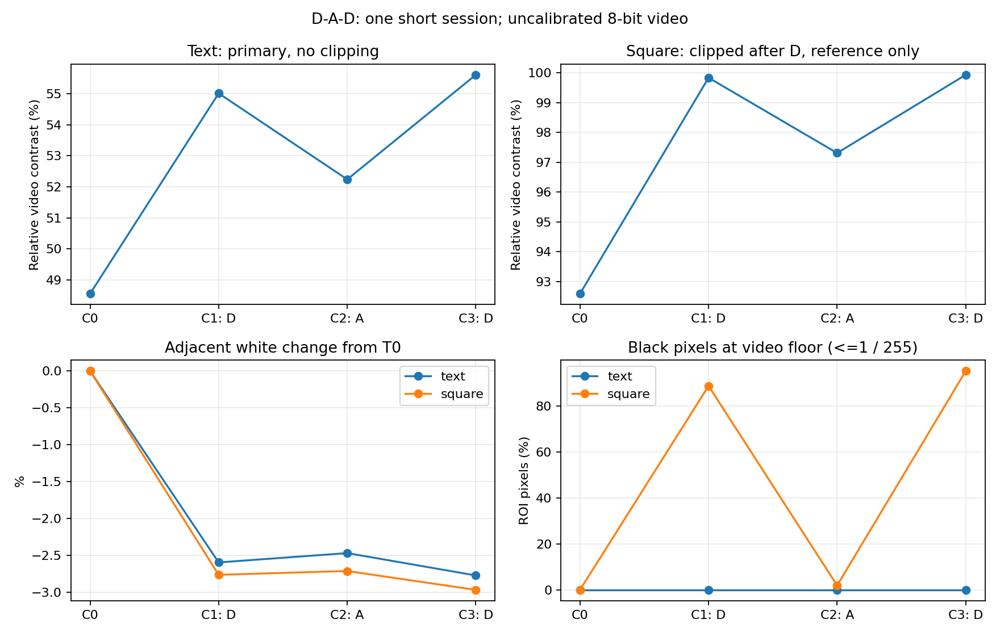
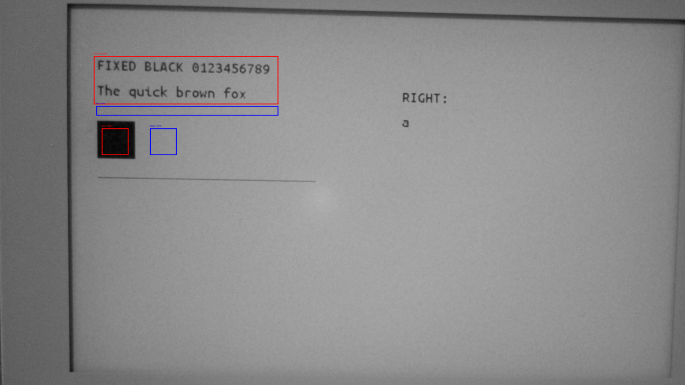
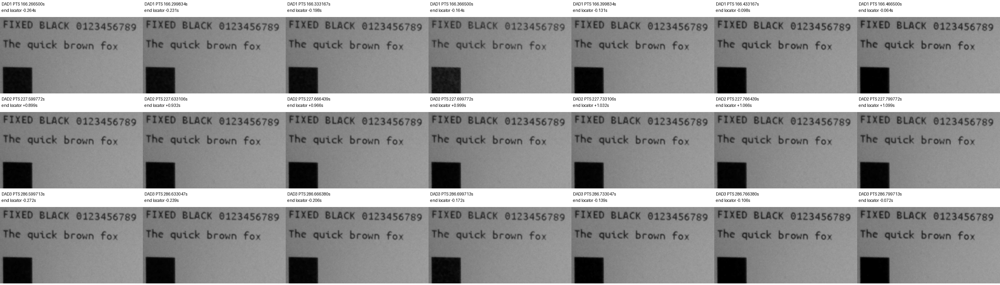

# SSD1677 D→A→D：実機・動画解析結果（2026-10-18）

**判定：DAD-1「再黒化を確認」を、今回の短期・相対映像解析が支持。** 黒つぶれのない固定文字ROIで、初回D後55.01%→A後52.24%→再適用D後55.61%となった。Aで低下した後のdC3は+3.37pp、C3−C1は+0.60ppで、概ね初回D後の水準へ戻った。一方、ユーザー目視は全段階「濃さほぼ不変・背景正常」であり、肉眼で差を確認した結果ではない。

黒四角はD後に映像の黒下限へ飽和したため、数値を参考扱いとし、正確な回復率・D1とD3の濃さ比較に使わない。単一セッションの未校正8bit映像なので、実用周期、長期安全性、効果の統計的再現性は未確定。

上限3回・D計2回で終了し、予定OTP cleanup後に元IntegrationをApplication-onlyで復元した。Application読戻し、各書込み前後の保護領域一致、USB Shell/Launcher起動、ユーザー正常表示確認まで完了した。**依頼書§7・§14に従いGate 2前で停止する。Writer Trialの実装は未着手。**

## Git・実装・検証済み成果物

| 項目 | 結果 |
|---|---|
| Branch | `experiment/papermono-black-hold-dad` |
| Worktree | `E:\ESP32\M5PapserMono-SolarOS\.research\black-hold-dad\worktree` |
| 基点 | `1e11d7fc09b47f2b0d07e328524632b6f5f0ed9d` |
| 製品実装Commit | `e5b307cc6515b7a8bbcd3344924f453d50effa47` |
| Flash時HEAD | `04e5697b8cf2556420a34131c4a614a53fae3037`（準備報告Commit。製品コード/Binaryは実装Commitと同じ） |
| Trial Application | 3,460,720 B、SHA-256 `647534b1231faf8945f0fb15566ab0be1eb21d62715cd612aedcd92533a6ddc0` |
| Build | ESP-IDF5.5.5 / GCC14.2.0、m5paper_mono / writerdeck / ota、278.9秒、warning/error各0、PASS |
| Host | DAD Driver・Shell20ケース、旧DAA Driver・Shell20ケース、旧repeat3 Driver・Shell17ケース、旧単発Driver・Shell10ケース、Waveform・独立LUT Python2件、主要Host19実行ファイル＋Sketch Python9件PASS |
| 実機段階の製品コード変更 | なし。凍結した同じApplicationをSHA照合して使用 |

変更10ファイル・Buildフラグ・Host詳細は[準備報告](m5paper-mono-black-hold-dad-20261018.md)を参照。前回の画像生成、OTP、排他claim、immutable submission、LUT復帰、RAMモデル、gate、60秒タイマー、光学解析を再利用した。LUT配列・電圧・FR/Timing、通常refresh本体、Dirty rows-dual、App/Service/Board、Writer/Sketch/TypeMouse、startupを変更していない。

## Flash・復元・最終Firmware

ユーザーの明示Flash承認後、USB接続・未保存なし・実機競合なし・表示正常を確認した。COM39のUSB識別と実行/起動`ota_0`、ESP32-S3、MAC `28:84:85:44:79:68`、Flash ID `0x184046`・16MiB、実Partition、otadata CRC/選択を現物確認した。ota_0はoffset`0x10000`、容量`0x700000`。新規16MiB全Flashと現行Applicationを保存し、現行Applicationは既知Integrationと一致した。

書込み対象はApplicationだけ。Trial読戻しSHAは上表と一致し、Bootloader・Partition table・NVS・otadata・PHY・FATの6領域は書込み直前/直後で一致した。試験終了後もセッション・slot・競合を再確認し、新規保存した元Applicationだけを復元。復元Applicationは保存binとバイト一致し、復元直前/直後の6保護領域も一致した。

| 最終状態 | 結果 |
|---|---|
| 復元Integration | `391925abff2d261d1d5856711aa0a1f101ac435a` |
| Application SHA-256 | `278665c184653f06a403bd56713e7bf5073131bead0420b3fd2191fa54b12ef6` |
| 実行/起動 | ota_0、SolarOS4.16.1 / writerdeck |
| USB・画面 | USB Shell応答、Launcher active、最後にユーザー「Launcher（またはShell）の表示は正常」 |
| startup | USB Shell作成、`refresh=fastest`・`fastest-path=tile`を維持 |

開始時と復元時のNVS/FATのhashは異なるが、各Flash操作の直前/直後では一致した。試験中の変更内容の内訳は未解析であり、「全試験期間で不変」とはしない。全Flashを書き戻してユーザーデータ・履歴を巻き戻さず、復元直前のデータを保持した。保存文書の編集・保存、BLE再ペアリング、追加のWriter/Sketch/TypeMouse実機回帰は行っていない。これらのHost回帰は準備時PASS。

**最終実機は元Integration。D Trialを常用状態に残していない。** 新規バックアップはローカル`.research/black-hold-dad/archive/20261018-dad/`の`full-flash-before.bin`・`ota0-app-rollback.bin`。使用済み復元helperは`.research/black-hold-dad/restore_single_guarded.py`。raw Flash・Firmware・元動画をGitへ追加していない。既存27 Worktreeの状態は最終監査で全件不変、実用Branchへのmerge/pushはない。

## 更新回数・LUT送信・時間

各gateでユーザー回答を受け、1段階分の`g`だけを送った。予約・成功は3回、Dは1/3回目の計2回、Aは2回目の1回。失敗・cancel・timeout・自動再試行0。測定間にOTP・初期画像再描画・RAM/Shadow再初期化を挟んでいない。

| 工程 | 診断内0x20 |
|---|---:|
| OTP full白 | 2 |
| OTP full共通画像 | 2 |
| Baseline初回custom（測定外） | 1 |
| D→A→D測定 | 3 |
| 予定OTP cleanup | 2 |
| **合計** | **10** |

通常UI/boot表示は別集計で、全稼働時間の更新総数を10とするものではない。4回目のための実機操作はしていない。SPI実効20MHz、fastest＋tile、Dirty rows-dualを使用。同一48,000B画像の全RAM強制更新なので、通常Writerの局所Dirty性能とは区別する。

| 更新 | LUT0要求 | RAM payload B | RAM SPI API ms | BUSY待機相当 ms | Driver＋LUT復帰総 ms | 0x20 |
|---|---|---:|---:|---:|---:|---:|
| D1 | 2F F0 | 144,000 | 62.755 | 51.582 | 168.562 | 1 |
| A2 | 00 00 | 144,000 | 61.721 | 51.687 | 166.803 | 1 |
| D3 | 2F F0 | 144,000 | 61.635 | 51.363 | 167.851 | 1 |

平均は総167.739ms／BUSY51.544ms／RAM SPI API62.037ms。BUSYはAPI待機相当でedge計測ではなく、SPIはRAM API累計で単純なwire時間ではない。総時間は診断のLUT復帰を含み、BLE入力→肉眼表示完了の遅延ではない。この3点だけで速度の統計的同等性は主張しない。

全測定で`03/04/2C`各1回、`32`2回、`20`1回。`BH lut`の要求値は`2FF0/0000/2FF0`、全回`lut_send_ok=1 baseline_restore_ok=1 physical_readback=0`。Baseline復帰に追加`0x20`なし。Hostでは全payloadと順序を検証し、実機は送信成功ログによる確認。物理LUT readbackではない。

| 区間 | 前回完了→次回Driver開始 | 完了→Tn |
|---|---:|---:|
| 準備→D1 | 60.004973s | 2.000649s |
| D1→A2 | 60.005255s | 2.000589s |
| A2→D3 | 60.005601s | 2.000139s |

各回の承認が目標前に届き、60秒目標から約5.0〜5.6msの超過に揃った。T0は前回と同じ準備完了＋5秒。承認なしの自動継続はない。OTPのBH RAM欄0はその計測欄未設定で、RAM転送なしではない。OTP各phaseとtotalログを保存している。

## 元動画・測定品質

原本は`C:\Users\takec\Videos\DAD\20261018-181335.avi`、2,470,595,708 B、SHA-256 `445b38761b6e1a3a3ef45cd640d7f85ea63578c27f8fd283f7c3ffc1660270b7`。ファイル名、作成18:13:35.074→最終更新18:18:59.718（JST）、duration324.480秒、3840×2160・nominal30fpsを確認した。metadata経過とdurationの差は約0.164秒。

USB終了受信時刻はD1=18:16:21.604、A2=18:17:21.775、D3=18:18:21.946。原本の概略位置はT0=111.359秒、T1=168.525秒、T2=228.703秒、T3=288.875秒で、録画範囲・順序・約60秒間隔と映像内変化に整合した。原本は変更せず抽出した。USB受信時刻−PC作成時刻は概略locatorで、カメラ同期は校正していない。

ユーザー申告はInsta360 Linkの前回と同じ固定条件：4K30、露出/Gain・WB・focus・本体/カメラ位置固定（前回focus9%、今回同設定との申告）。WB等の数値は再照合していない。自然光は前回遮断不可で、新たな遮断成功の申告はない。温度未測定。

T0で既存ROIとの対応を確認して凍結した。黒四角`[570,720,720,870]`／白`[840,720,990,870]`、文字patch`[525,315,1560,585]`／白`[540,594,1560,648]`。文字maskはT0で白×0.65未満の27,117画素に固定。各Tnの0/0.5/1秒後の3frame中央値、各更新前後263 native frameを解析した。反復frameを独立した試行数として扱わない。

## C0〜C3と再適用Dの回復

C=`(近傍白−黒)/近傍白`。CはC×100（%）、変化はpercentage point（pp）。反射率や校正測光値ではない。

| 段階 | 波形 | 固定文字C（主評価） | 文字dC | 文字ΔC | 黒四角C（参考・飽和あり） |
|---|---|---:|---:|---:|---:|
| C0 | 共通初期化 | 48.56 | — | 0 | 92.59 |
| C1 | D | 55.01 | +6.45 | +6.45 | 99.83 |
| C2 | A | 52.24 | **−2.77** | +3.68 | 97.31 |
| C3 | D | 55.61 | **+3.37** | +7.05 | 99.93 |

| 指標 | 固定文字 | 黒四角（参考） |
|---|---:|---:|
| dC1 | +6.45pp | +7.24pp |
| dC2 | −2.77pp | −2.52pp |
| dC3 | +3.37pp | +2.62pp |
| C3−C1 | +0.60pp | 正確なD1/D3比較には使わない |
| 参考回復率 `(C3−C2)/(C1−C2)` | 約121.5% | **算出・採用しない**（黒下限飽和） |

文字のC1−C2=2.77ppは更新直前の文字C変動range（約0.45〜0.56pp）より大きく、各mask閾値でもA低下→D回復を維持したため、回復率を参考算出した。ただし未校正カメラ・少数frameの中央値による値であり、「物理的に121.5%回復」「初回より有意に濃い」とは判断しない。**初回D後と概ね同水準へ回復**したという評価にとどめる。

黒四角の黒clip（値≤1/255）率はC0=0%、C1=88.62%、C2=1.92%、C3=95.09%。D後は黒下限に達し、真の黒さやD1/D3差を測れない。99.83/99.93%をパネルの物理濃度や完全黒化率として解釈しない。ROIを狭めても同様の飽和があり、四角の正確な回復量は未確認。一方、固定文字の黒/白clip率は全Tnと解析した更新窓で0%だった。

近傍白のT0比は文字側0／−2.60／−2.47／−2.77%、四角側0／−2.76／−2.71／−2.97%。長い待機中の照明・反射・表示履歴による変動は分離しきれない。初回D直前の文字Cは50.45%で、T0から既に変動しているため、dC1全量をDだけの効果とはしない。

各更新直前約4.7秒の文字白rangeは0.38〜0.45%、短い更新前後の白変動は−0.10/+0.33/+0.03%。局所直前→直後の文字CはD1 **+4.81pp**、A2 **−2.62pp**、D3 **+3.27pp**で、長い待機を含むC0〜C3と同じ方向だった。反射等の残余誤差はあるが、長時間の白基準ドリフトだけで順位を決めていない。

文字mask閾値0.55/0.65/0.75のdC2は−2.96/−2.77/−2.49pp、dC3は+3.48/+3.37/+3.11pp。ROI・maskを結果に合わせて選び直していない。黒四角の内側20px確認は方向確認だけで、飽和制約を解消しない。

## 過渡変化・目視・異常

終了locator±1秒の最小値を、局所直前中央値と比較した参考値。

| 更新 | 文字raw最小差 | 文字median3最小差 | 四角raw最小差（参考） | 四角median3最小差（参考） |
|---|---:|---:|---:|---:|
| D1 | −5.49pp | −0.07pp | −11.07pp | −0.17pp |
| A2 | −2.81pp | −2.78pp | −2.40pp | −2.36pp |
| D3 | −2.71pp | −0.28pp | −3.00pp | −1.00pp |

Dの短い薄まりの後に黒化する様子が接触シートにある。rawの短い谷は3frame中央値で小さくなり、30fpsでは正確な波形phaseや持続時間を確定できない。Aの最小値は薄くなった安定状態も含むため、すべてを過渡白化と解釈しない。

D1近傍に66.667msのnative PTS gapが1か所（終了概略−1.631〜−1.564秒）。A2/D3の解析窓は50ms超gapなし。camera内露出の重複は未確認。大きな撮影者影は確認されなかったが、自然光・微弱反射を完全には否定しない。

ユーザーはD1、A2、D3とも「濃さほぼ不変・背景正常」、録画終了時「目立つちらつきなし」と回答した。今回、短い従来同程度の白化だけを停止・不採用理由にしていない。長時間残る白化、著しい白背景汚染、表示反転、強い残像、Driver fault、BUSY timeout、LUT復帰失敗は確認されなかった。

## 判断・次のGate

文字ROIの「初回Dで上昇→Aで低下→Dで再上昇」、局所前後差、mask感度の方向一致と正常Driver状態から**DAD-1**とする。黒四角の量的回復とD1/D3差は飽和により未確認だが、文字ROIの比較全体を不能にする外乱は確認されなかった。目視差未確認・未校正映像という制約は残る。

前回DAAのP-2と今回DAD-1は、通常Aで薄まった後にDを再適用して回復する方式を支持する。ただし別セッションで初期黒さ・照明・映像飽和状態が異なり、効果量の直接比較はしない。毎回D・数回に1回・品質低下時の適用のどれが最適か、この3回では決められない。2回に1回を最適周期としない。

次はユーザーがこの結果を確認し、**Gate 2としてWriter Trial実装へ続行するか判断する段階**。承認されるまでは実装しない。承認後は独立Worktreeで通常Writerの実Dirty更新を使用し、D物理更新最大6回・通常A比較・非同期LUT整合を検証する。Host/Build後のFlashはGate 3で別承認、実用Integration採用はGate 4で別判断となる。

今回は新Candidate・新波形・電圧変更・pacing・4回目・WriterへのD導入・実用Branchへのmerge/pushへ進んでいない。短い白化のゼロ化をP0必須目標にしない。視覚上の許容性とは別に、実効DC、残留電荷、長期寿命、メーカー適合は未確認のままである。

## 証拠

[測定JSON](evidence/black-hold-dad-results-20261018/DAD-measurements.json)、[raw USB](evidence/black-hold-dad-results-20261018/dad-usb.log)、[Flash監査](evidence/black-hold-dad-results-20261018/flash-summary.json)、[復元監査](evidence/black-hold-dad-results-20261018/final-deployment-audit.json)、[原本照合](evidence/black-hold-dad-results-20261018/video-sources.json)、[抽出時刻](evidence/black-hold-dad-results-20261018/extraction.json)、[ROI結果](evidence/black-hold-dad-results-20261018/DAD-roi.json)、[感度・PTS](evidence/black-hold-dad-results-20261018/robustness.json)、[判定](evidence/black-hold-dad-results-20261018/classification.json)、[証拠SHA](evidence/black-hold-dad-results-20261018/evidence-index.json)。

