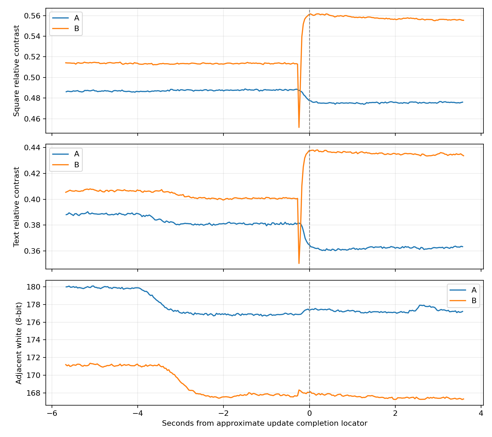

# SSD1677 Candidate B再現性確認・Phase 1実機結果（2026-10-17）

判定は **B-1：動画の相対コントラストで黒化方向を再観測**。Baseline Aでは低下、撮り直しBでは黒四角・文字の双方で上昇した。黒つぶれは検出されず、更新直近の白地変化だけではBの段差を説明しにくい。ただし撮影位置・倍率と照明に差があり、校正済み測光や長期安定性の証明ではない。目視回答はA/Bとも「濃さほぼ不変」。動画指標と目視を区別する。

元のIntegrationへapplication-onlyで復元済み。読戻しSHA・保護領域一致、USB Shell・Launcher起動、ユーザーの正常表示確認まで完了。**Dは未実装。Phase 2・反復試験・実用版への統合は行っていない。**

## 元動画の対応確認

以下はすべて2026-10-17、日本時間。元動画は読み取りだけで、改名・移動・上書きしていない。

| 条件 | `C:\Users\takec\Videos\AB` 内の原動画 | 録画時間 | 更新完了のUSB受信時刻 |
|---|---|---:|---|
| A：Baseline | `20261017-123603.avi` | 2分02.98秒 | 12:37:24.962 |
| 影入りB：主比較から除外 | `20261017-124131.avi` | 2分28.80秒 | 12:43:12.074 |
| 撮り直しB：主比較に採用 | `20261017-125153.avi` | 2分04.83秒 | 12:53:28.075 |

3本とも3840×2160、30fps、MJPEG AVI。ファイル名の時刻、録画時間、最終更新日時、USBログ、該当区間の共通試験画像を照合した。更新完了はPCのUSB受信時刻であり、画素の発光／反射変化時刻を直接測った値ではない。

- A：作成12:36:03.197、最終更新12:38:06.335。動画開始から測定完了まで約81.77秒、T0約76.59秒、T1約83.77秒。
- 影入りB：**Windows作成日時がAと同じ12:36:03.197になっており、撮影開始の根拠に使えない。** ファイル名は12:41:31、最終更新12:44:01.002。録画長を差し引いた開始推定は12:41:32.202で、今回Bの12:43台のログと整合する。原因は未確認。主比較からはユーザー申告の影を理由に除外し、再解析で無理に補正しない。
- 撮り直しB：作成12:51:53.600、最終更新12:53:58.626。動画開始から測定完了まで約94.48秒、T0約89.30秒、T1約96.48秒。
- 以前指定された`Videos/A.avi`はSHA-256が過去Candidate C動画と完全一致したため、今回のAには使用していない。今回Aは以前`B_discard.avi`と指定された内容とhash一致。撮り直しBは以前`B.avi`とhash一致。

3本のhash・メタデータは[動画時刻照合JSON](evidence/black-hold-repro-b-20261017/video-time-verification.json)。映像の対応は[照合用T0/T1一覧](evidence/black-hold-repro-b-20261017/video-association-contact-sheet.png)。

## 実装・Host・Build

| 項目 | 結果 |
|---|---|
| Branch | `experiment/papermono-black-hold-repro-b` |
| Worktree | `E:\ESP32\M5PapserMono-SolarOS\.research\black-hold-repro-b\worktree` |
| 実装Commit | `e9f5989671c968f69e5c35893fb4c7573dd7da8a` |
| 準備記録Commit | `3541845267ef01cff3108db97ec27bfd7e02a0dc` |
| Application SHA-256 | `4e8e7ed51d0d6dbf2adf8fdf5ca8f6c4d55456f153a8aa7325a63fe2b8d38b8c` |
| Applicationサイズ | 3,457,728 B |
| Host | Driver/SPI、単発制限、Baseline復帰、R0/R2、固定時刻・中断の4シナリオ、独立B LUTデコード、主要19実行ファイル＋Sketch Python 9件：PASS |
| ESP32-S3 Build | ESP-IDF 5.5.5／GCC 14.2、252.25秒、compile/link PASS、ログwarning/errorなし |

変更は既存診断Shellの待機条件とそのHostテストのみ。Bの110バイトLUTは旧Bと完全一致、LUT0=`8F F0`。LUT1〜4、FR、電圧値、Driver更新シーケンス、Dirty rows-dual、Appsは無変更。通常fastestはBaseline。詳細は[準備時点の記録](m5paper-mono-black-hold-repro-b-20261017.md)。

## 実機手順と回数

COM39、ESP32-S3、MAC `28:84:85:44:79:68`、16MB、実行／起動ota_0（offset `0x10000`、size `0x700000`、valid）を確認。各導入前に新しい全Flash・Applicationバックアップを取得し、partitionとOTA選択を検証してApplicationだけを書いた。初回と撮り直しの導入／復元の4書込みすべてで読戻しとbootloader／partition／NVS／FAT／otadata／PHYの書込み前後一致を確認した。通常実行中にこれらが一切変化しなかったという意味ではない。全Flashの巻戻しは行っていない。

A→Bを各1回実施。初回B後にユーザーから影の申告と撮り直し指示を受け、いったんIntegrationへの復元を完了してから、同じTrialを再導入して**Bだけ追加1回**。A、旧C、Dは再実行していない。

1条件の診断内0x20は、白OTP full 2＋共通画像OTP full 2＋初回custom 1＋測定1＋cleanup OTP full 2＝**8回**。A・影入りB・撮り直しBで診断内計**24回**、候補Bの物理更新は計**2回**。起動・Shell／Launcher復帰など通常UIの更新はこの診断カウンタの外にあり、全期間の総更新数を24回と主張しない。LUTのBaseline復帰は0x32再送のみで追加0x20なし。Driverのreadbackをしたわけではない。

各条件の初期化はOTP full白→OTP full共通画像→Baseline初回custom。以後は白確認後にユーザー応答待ちを入れず固定時刻で進行した。

| 実測間隔 | A | 撮り直しB |
|---|---:|---:|
| 初回custom完了→T0 | 5,000.329 ms | 5,000.385 ms |
| 初回custom完了→測定Driver開始 | 10,004.655 ms | 10,004.722 ms |
| T0→測定Driver開始 | 5,004.326 ms | 5,004.337 ms |
| 測定Driver完了→T1 | 2,000.700 ms | 2,000.083 ms |

## 更新時間・コマンド

| 温間測定1回 | A | 撮り直しB |
|---|---:|---:|
| SPI実効周波数 | 20 MHz | 20 MHz |
| RAMデータ | 144,000 B | 144,000 B |
| SPI API計測合計 | 61.771 ms | 62.233 ms |
| BUSY | 51.926 ms | 51.125 ms |
| Driver処理＋Baseline LUT復帰 | 169.974 ms | 169.576 ms |
| 0x03／0x04／0x2C | 各1 | 各1 |
| 0x32 | 2（測定＋Baseline復帰） | 2（測定＋Baseline復帰） |
| 0x20 | 1 | 1 |

同一画像を強制的に更新する診断なので、通常Writerの小領域更新の速度とは比較しない。SPI API合計は純粋なwire時間ではない。影入りBの参考ログはSPI 62.189 ms、BUSY 51.142 ms、全体168.811 ms、0x20=1。全条件エラー／timeoutなし。

## 撮影条件と解析方法

Insta360 Link／Link Controller、4K30、露出・Gain手動固定（数値未提供）、focus19%、4100K、明るさ81%、contrast45%、彩度0%、sharpness26%、anti-flicker60Hz、露出曲線linear。以上はユーザー申告で、Controller設定のreadbackではない。温度計なしでパネル温度は未測定。自然光の混入可能性あり。

Aと撮り直しBは映像上、パネル位置・倍率に差がある。両動画へ同じ画像座標や共通文字maskを適用せず、対応する黒四角内部・固定2行文字・近傍白を各動画で設定し、動画内でROIとT0文字maskを固定した。maskはT0で近傍白の0.65倍未満。原動画に幾何変換をしていない。位置差があるので、A/Bの絶対濃度が完全同条件だったとは扱わない。

`C=(白−黒)/白`。T0/T1マーカー後0、0.5、1秒の3フレームの中央値を採用。同じセッション内の差`ΔC`と`Δ改善=ΔC_B−ΔC_A`を見る。原解像度のnative PTSを記録し、frame群を独立した反復試験とは扱わない。PCファイル時刻とUSB受信時刻による対応は近似で、校正済みのcamera/controller同期ではない。実際の更新の過渡変化は推定位置付近に確認できたが、特定のLUT位相や正確な白化時間は断定しない。

## 黒化と過渡変化

| 相対コントラスト | A T0 | A T1 | A ΔC | B T0 | B T1 | B ΔC | Δ改善 |
|---|---:|---:|---:|---:|---:|---:|---:|
| 黒四角 | 0.48665 | 0.47589 | −1.08 pp | 0.51424 | 0.55659 | ＋4.23 pp | **＋5.31 pp** |
| 固定文字 | 0.38871 | 0.36213 | −2.66 pp | 0.40670 | 0.43510 | ＋2.84 pp | **＋5.50 pp** |

T0のB−A差は黒四角＋2.76 pp、文字＋1.80 ppで完全一致ではない。前回のB/Cの絶対値と直接比較して優劣を決めない。

| 更新近傍の最小値 | A 黒四角 | B 黒四角 | A 文字 | B 文字 |
|---|---:|---:|---:|---:|
| 生フレーム最小C | 0.47413 | 0.45163 | 0.36009 | 0.35020 |
| 3フレーム移動中央値の最小C | 0.47498 | 0.49510 | 0.36027 | 0.37391 |
| 生最小のT0からの低下 | 1.25 pp | 6.26 pp | 2.86 pp | 5.65 pp |
| 移動中央値のT0からの低下 | 1.17 pp | 1.91 pp | 2.84 pp | 3.28 pp |

Bは更新途中に短い低下があり、その後T0を上回っている。30fps・ローリングシャッター・同期誤差があり、単一フレームを特定LUT位相の応答や厳密な薄まり時間とは解釈しない。目視ではAは「濃さほぼ不変・背景正常・目立つちらつきなし」、撮り直しBは「濃さほぼ不変・背景正常・影なし」。Bのちらつきについて独立した明示回答はない。

T0→T1の近傍白は黒四角A −1.44%、B −2.16%、文字A −1.55%、B −2.06%。光学外乱がゼロとは言えない。補助的に更新直近の固定窓（推定Driver完了−0.75〜−0.5秒と＋0.2〜＋0.45秒）を比較すると、Bの白地は黒四角＋0.041%、文字＋0.031%に対し、Cは＋4.77 pp／＋3.62 ppの段差。単純な一様明るさ変化だけでは説明しにくいが、カメラ応答・局所反射等を完全に除外したわけではない。

T0/T1標本の黒クリップ（8bit値≤1）・白クリップ（≥254）は各ROIで0%。前回Bで問題になった黒つぶれによる上限付近の飽和は今回の測定ROIでは検出しなかった。校正反射率や統計的有意差は主張しない。

## Phase 1の判定・最終状態

**B-1：黒化方向の再現性を支持する追加結果。** 黒四角と文字が同方向、Aで同等の黒化なし、黒clipなし、更新直近の白変動も小さいため。ただし撮影幾何・T0濃度・自然光・温度は完全統一できておらず、効果量の厳密な再現や長期安全性を保証しない。目視だけなら今回の改善は未確認であることも併記する。

Phase 2のD単発比較を検討する根拠は得られた。**Phase 1はここで停止し、ユーザーの別承認を受けるまでDを実装しない。** DのHost・Build後も実機Flash前に再承認を得る。短期反復Trialは今回行わない。

最終ApplicationはIntegration `391925abff2d261d1d5856711aa0a1f101ac435a`、SHA-256 `278665c184653f06a403bd56713e7bf5073131bead0420b3fd2191fa54b12ef6`。Dirty Rectangle＋Sketch高速化＋TypeMouse長押し固定・反転を含む。startupのfastest＋tileを維持。Launcher正常はユーザー確認済み。実用Branchへのmerge／pushなし。

生ログ・バックアップ・原解像度抽出・ROI設定・native時系列は`.research/black-hold-repro-b/archive/20261017-repro-b`と`20261017-repro-b-retake`に保存。全FlashバックアップをGitへ追加していない。構造化結果は[results.json](evidence/black-hold-repro-b-20261017/results.json)。今回の動画は今後も上表のファイル名とSHA-256で特定する。
