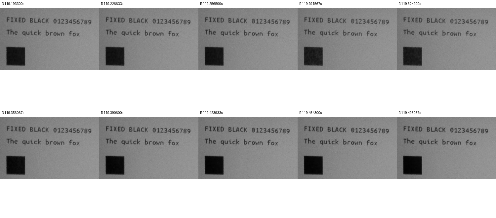
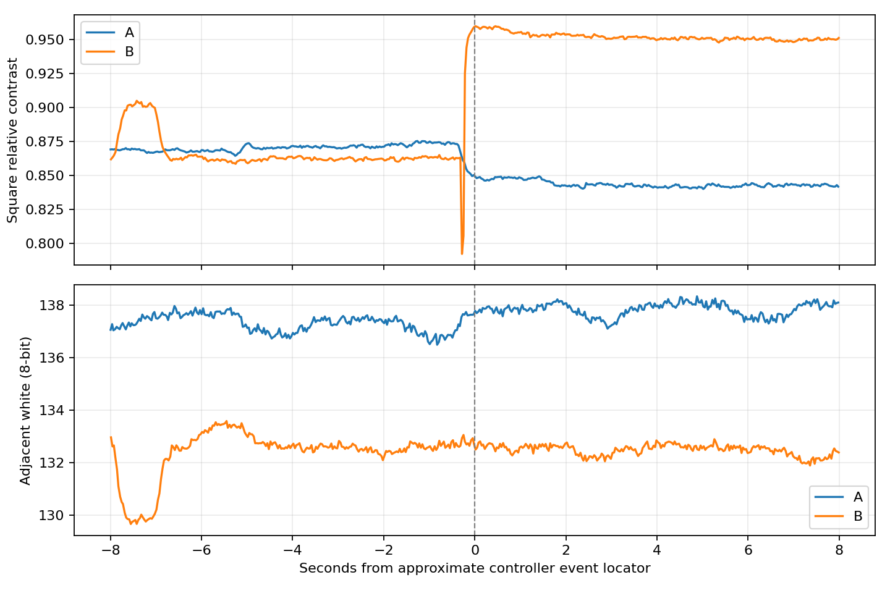

# SSD1677 黒→黒補償・単発A/B実機結果（2026-10-17）

## 結論

承認されたA/Bを各1回だけ実施した。B（LUT0=`8F F0`）は単発後に固定黒が濃くなり、ユーザー目視と動画の相対コントラストが同じ方向を示した。一方、動画には更新途中の短い薄まりも認められる。**単発の黒化作用は確認できたが、現候補の短期反復Trialは推奨しない。** 依頼書9節の「白化や画質悪化が認められた場合、Candidateは継続試験の対象にしない」に従い、途中の薄まりを含めてユーザーへ報告する。追加実行・実用版統合はしていない。

試験前のIntegration Applicationへ復元済み。読戻しSHA-256、各書込み前後の保護領域一致、USB Shell・Launcher起動を確認し、ユーザーも最後に「Launcher表示は正常」と確認した。

## 1. 基点・実装・検証

| 項目 | 内容 |
|---|---|
| Branch | `experiment/papermono-black-hold-single` |
| Worktree | `E:\ESP32\M5PapserMono-SolarOS\.research\black-hold-single\worktree` |
| 基点Integration | `391925abff2d261d1d5856711aa0a1f101ac435a` |
| Trial実装 | `60012235d6d9df886f670449cbb07b5e3a717aeb` |
| デコーダ検証・準備報告 | `9f2c47241c3cfb5c6d7b0cbf1ac4d509cd75000a` |
| 今回書き込んだソースHEAD | `ab57350d4036b5b61e52d01f01594350b6865119`（追加分は保留記録） |
| Trial Application | 3,458,656 B、SHA-256 `97d92273012ea11fa7b423ea38be8a8c9261071c5502e380028c3b35ceaa2cea` |
| 復元したIntegration | 3,455,712 B、SHA-256 `278665c184653f06a403bd56713e7bf5073131bead0420b3fd2191fa54b12ef6` |

実装・Host・ビルドの詳細は[準備報告](m5paper-mono-black-hold-single-20261016.md)。10月16日の保留後、10月17日に書込み・単発A/B・復元の明示承認を受けた。今回、準備済みの実装や波形を変更していない。

変更対象は `scripts/platformio_solaros_flavor.py`、`src/CMakeLists.txt`、Driverの `epd_ssd1677.c/.h`・`epd_ssd1677_reference.inc`・`epd_ssd1677_waveform_trial.inc`、Shellの `solar_os_shell_black_hold_single.inc`・`solar_os_shell_commands.c`、Host Makefile・Driver/Shellテスト・Python LUTテスト。既存Apps、Dirtyアルゴリズム、Sketch、TypeMouse、Writerは無変更。

Hostは既存主要19実行ファイル＋Python 9件、新Driver、Shell R0/R2・BUSY失敗、独立LUTデコード、既存waveformテストがPASS。ESP-IDF 5.5.5／GCC 14.2.0のESP32-S3 build/linkはPASS（224.79秒、ログのwarning/errorなし）。これは準備時の結果で、今回同じソース・同じバイナリを使用した。

## 2. コード上の事実：変更はLUT0の2バイト

Candidate LUT0の10バイトは `8F F0 00 00 00 00 00 00 00 00`。Baselineとの差分は全110バイト中offset 0・1だけ。LUT1〜4、タイミング、FR、Gate/Source/VCOM値は一致する。

| Phase | 公称Source | Frames |
|---|---:|---:|
| 0A | −15V | 2 |
| 0B | 0V | 2 |
| 0C / 0D | ＋5V | 各2 |
| 1A / 1B | ＋5V | 各1 |

計10フレーム。公称Source時間積は0 V・frameだが、VCOMやキックバック等を含む実効DCバランス、寿命、メーカー適合性は未確認。デコード根拠は[SSD1677 Rev1.0](https://files.waveshare.com/upload/2/2a/SSD1677_1.0.pdf) §6.6 Table6-6、§6.7 Figure6-6と準備報告を参照。

専用Shellの単発要求のみ無変更更新を許可し、通常のno-op省略を維持。Bは1起動につき最大1回。A/BともBUSY完了後にBaseline LUTを同じように再送し、復元時に追加の`0x20`は発行しない。実機レジスタreadbackはしていないため、LUT復元確認は成功送信ログによる。

## 3. Flash・初期化・更新回数

COM39／ESP32-S3／16MBを再確認。実行・起動とも`ota_0`（offset `0x10000`、size `0x700000`）、OTA状態valid。全Flashと実用Applicationを退避後、Application-onlyでTrialを書込み、読戻しSHAを照合した。終了時も退避したApplicationだけを同slotへ戻した。

Trial書込み・復元書込みのそれぞれで、bootloader、partition table、NVS、otadata、PHY、FATの直前・直後ハッシュが一致。BLE bond・保存文書を含む領域は書込み対象外。通常稼働に伴う履歴等の変化まで含めて「試験全期間のNVS/FATが不変」とはしていない。startupは`refresh=fastest`／`fastest-path=tile`を維持。

| 各条件の処理 | `0x20`成功発行数 |
|---|---:|
| OTP full 白 | 2 |
| OTP full 共通画像 | 2 |
| Baseline初回custom・同一画像 | 1 |
| T0後の温間測定（AまたはB） | 1 |
| T1後のOTP full cleanup | 2 |
| 合計／条件 | 8 |

診断内はA/B計16回、**Candidateの物理activationはBの1回のみ**。起動・Shell・Launcher復帰の通常描画は診断カウンタの範囲外。T0/T1の撮影待ち中に追加測定はしていない。Launcherを閉じてforeground Shellを確保し、同じ固定画像を保持した。SPI actualは全条件20MHz、fastest＋tile、rows-dual。

## 4. 実機ログ・更新時間

| 温間測定・各1回 | A Baseline | B Candidate |
|---|---:|---:|
| 全体時間（Baseline LUT復元込み） | 170.014 ms | 166.003 ms |
| BUSY | 51.827 ms | 51.073 ms |
| SPI API呼出し時間合計 | 62.181 ms | 61.622 ms |
| RAM payload | 144,000 B | 144,000 B |
| `0x03 / 0x04 / 0x2C` | 各1 | 各1 |
| `0x32` | 2 | 2 |
| `0x22=0x0C` → `0x20` | 1組 | 1組 |
| エラー／timeout | なし | なし |

準備の初回customはA 541.322 ms／B 541.726 ms、BUSY 134.412／133.650 ms。温間測定は同一画像を強制更新する全RAM範囲であり、通常Writerの小さいDirty転送の速度とは比較しない。SPI欄は純粋なwire時間ではない。A/B各1回の約4ms差を高速化効果とは判断しない。

## 5. 元動画・T0/T1の相対コントラスト

ユーザー指定フォルダ`C:\Users\takec\Pictures\Camera Roll`の2動画を日時順に割当てた。原本は変更していない。

| 条件 | 元動画 | SHA-256 |
|---|---|---|
| A | `WIN_20261017_01_36_05_Pro.mp4` | `254c786495e85509017a08e2561096b129955efe2ebd20120b301fa59c4f7459` |
| B | `WIN_20261017_01_39_43_Pro.mp4` | `1590aa4eacdd67aa7041dcc1206c6c8476e9768e39304cb3065445d499bc8aa4` |

3840×2160、約30fpsの原解像度で解析した。写真と動画を同時撮影できないため、各条件の連続動画から静止フレームを抽出した。時刻はファイル時刻とログを使った概略位置を画像変化で確認し、安定した前3〜5秒／後3〜5秒の各3フレームの中央値を採用。3枚は独立した試行ではない。

同じ座標の黒四角内部 `[590,715,725,850)` と近傍白 `[800,715,935,850)` を使用し、`C=(白−黒)/白` を計算した。文字は `[555,370,1450,470)` 内のT0暗画素マスクを各動画内で固定、近傍白は `[570,470,1430,500)`。A/Bの別撮影の絶対輝度を同一視せず、各動画内の変化を比較する。

| 指標 | A T0 → T1 | B T0 → T1 |
|---|---:|---:|
| 黒四角の相対コントラスト | 0.8719 → 0.8410 | 0.8620 → 0.9507 |
| 同変化（percentage points） | −3.08 | ＋8.87 |
| 文字の相対コントラスト | 0.4589 → 0.4315 | 0.4562 → 0.4986 |
| 同変化（percentage points） | −2.74 | ＋4.23 |
| 近傍白の8bit値 | 137.14 → 137.96 | 132.83 → 132.62 |
| ユーザー目視 | 濃さほぼ不変 | T0より濃くなったように見えた |

Aは目視ではほぼ不変、カメラ指標では小さな低下を認めた。Bは両者で濃くなる方向。これは校正されていないカメラの符号化輝度による補助指標であり、厳密な光学濃度・反射率ではない。Bの黒は8bit平均約6.5と黒レベルに近く、非線形処理・圧縮・黒つぶれの影響がある。文字のマスクはA/Bで別に生成しており、文字指標の絶対値の厳密比較はしない。

## 6. 更新途中・異常の評価

ユーザーはA/Bとも「目立つちらつきなし・背景正常」と回答。一方、Bの動画119.291567秒のフレームで黒四角が一時的に薄くなり、相対コントラストは約0.7923へ低下、その後119.589800秒付近で約0.9600へ上昇した。黒四角は白地まで消えておらず、全面反転もない。

約30fps・露光積分・rolling shutter・ログとの同期誤差があるため、個々のLUT位相との対応や白化持続時間は確定しない。隣接白はこの変化中おおむね安定しており、画像は「固定黒の短い薄まり→黒化」と整合する。Bには更新より約7.5秒前にも近傍白が変動する区間があり、照明／撮影の外乱は完全には除けない。T0集計区間はそこを避けた。

BUSY timeout、更新失敗、想定外全面反転、背景汚染、終了後の強い残像、Driver faultは観測されなかった。途中の薄まりは「異常なし」に埋め込まず上記のとおり別記する。発熱・寿命・実効DCの計測はしていない。

## 7. 判定と最終状態

- **コードの事実**：差分2バイト、測定activation各1回、成功後のBaseline LUT再送、他の電圧・LUT・更新方式は同一。
- **実機観測**：Bの単発後に黒化。動画には短い薄まり。Aはカメラ指標で軽い低下。背景・終了状態は正常。
- **仮説**：黒→黒への補償駆動が黒化に寄与した可能性がある。カメラ外乱を完全に排除した因果確定ではない。
- **未確認**：反復時の保持・劣化、残留電荷、実効DC、長期安全性、他の画素遷移／温度での品質。

**次の短期反復：現候補では推奨しない。** 単発の黒化結果は研究上有用だが、依頼書の白化時の扱いに該当し得る途中の薄まりを認めた。追加の実機試験へ自動移行しない。まず今回の動画と評価を共有し、次の研究方針は別途ユーザー判断とする。

**実機の最終状態：元のIntegration版、Dirty Rectangle＋Sketch高速化＋TypeMouse長押し固定・キー反転を維持。補償Candidateは残していない。** USB ShellでSolarOS 4.16.1、ota_0 valid、Launcher active、startup維持を確認。ユーザーは最後にLauncherの正常表示を確認した。Writer／Sketch／TypeMouseを今回の復元後に追加操作させての再試験はしていない。

ローカル生ログ・バックアップ・全フレームは `E:\ESP32\M5PapserMono-SolarOS\.research\black-hold-single\archive\20261017-single`。`measurements.json`、`flash-summary.json`、`restore-summary.json`、`video-sources.json`、`analysis/roi-results.json`を参照。個人データを含むFlashバックアップや元動画はGitへ追加していない。集約結果と図だけを本報告書と同時に保存する。元Integrationおよび他のWorktreeへのmergeは行っていない。
