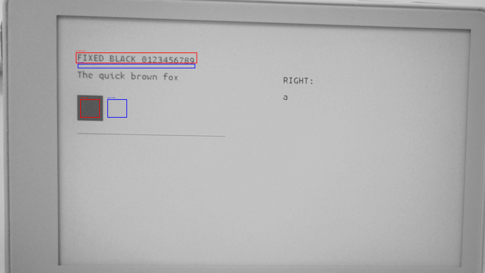
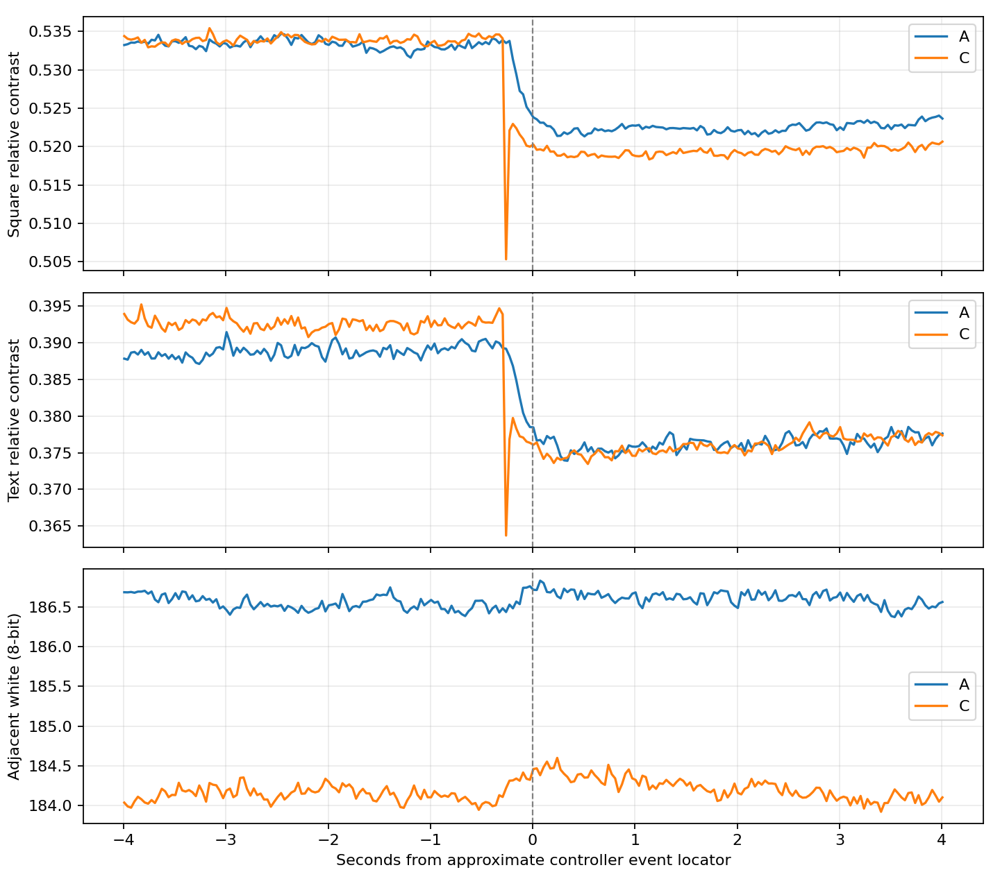
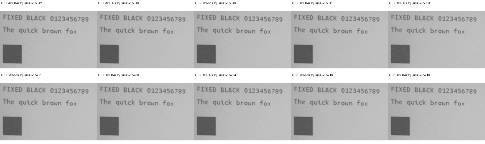

# SSD1677 Candidate C・単発A/C実機評価（2026-10-17）

## 結論

**今回の分類：3「黒化作用が不十分」**。承認されたA/Cを各1回だけ実行した。CのT1で黒化は確認できず、動画では更新近傍の短い薄まりが認められた。「更新後の黒化と過渡薄まり軽減の両立」を達成した結果ではない。これは今回の単発観測の判定で、Cが常に悪化する、パネルが劣化した、という断定ではない。

旧Bは再実行せず、Cの反復試験も実施していない。実用Integration Applicationへ復元し、読戻しSHA-256・保護領域一致・USB Shell・Launcher・startup維持を確認。ユーザーも最後に「Launcher表示は正常」と確認した。

## 1. ソース・成果物・変更範囲

| 項目 | 内容 |
|---|---|
| Branch | `experiment/papermono-black-hold-timing-c` |
| Worktree | `E:\ESP32\M5PapserMono-SolarOS\.research\black-hold-timing-c\worktree` |
| C実装 | `10213ae15385189461a8aff776a4cde49a911008` |
| 準備結果記録・書込み時HEAD | `f5e60b92007317fadc9ad75bb7a579d21babfa46`（実装以後は文書のみ） |
| 旧単発Trial基点 | `8f060acae3bbece08934985d85092ace3e2ae53b` |
| Integration基点 | `391925abff2d261d1d5856711aa0a1f101ac435a` |
| C Application | 3,457,728 B、SHA-256 `79fda106499056524f499dbf80a05b27dcce3e573b6fbdbfffa6b5afe5e5a6cb` |
| 復元Integration | 3,455,712 B、SHA-256 `278665c184653f06a403bd56713e7bf5073131bead0420b3fd2191fa54b12ef6` |

実装の5変更ファイル・Host・ビルド詳細は[準備報告](m5paper-mono-black-hold-timing-c-20261017.md)。DriverのCandidate配列とShellの条件名A/C、既存テストだけを変更した。Driver本体・reference更新シーケンス・Apps／Services・Dirty・Sketch・TypeMouse・Writer・SPI設定は旧Trialから無変更。独立Worktreeで作業し、既存21 WorktreeのHEADと変更状態を維持した。実用Branchへのmergeはしていない。

## 2. コードから確認したLUT

LUT0は`BF 00 00 00 00 00 00 00 00 00`。独立デコードは以下と完全一致した。

| Phase | Frames | 公称Source |
|---|---:|---:|
| 0A | 2 | VSL −15V |
| 0B / 0C / 0D | 各2 | VSH2 ＋5V |
| 1A / 1B | 各1 | VSS 0V（HOLD） |

計10フレーム、公称Source時間積`−15×2＋5×6=0 V・frame`。旧Bと電圧別のフレーム総数は一致し、HOLDの配置だけを変更。**Baselineの`00 00`との差分はoffset 0のみ**、旧Bの`8F F0`との差分はoffset 0・1。全110バイトのうちLUT1〜4・タイミング・FR・末尾電圧バイトは一致する。公称時間積0は実効DCバランス・残留電荷・寿命の証明ではない。

通常fastestはBaseline。Cは専用USB Shellから1起動につき最大1回で、budgetの失敗／cancel時返却はない。成功後A/CともBaseline LUTを再送し、復帰時に追加の物理activationは行わない。レジスタreadbackは未実施であり、Baseline復帰の確認は送信成功ログによる。

Hostは既存主要19実行ファイル＋Python 9件、新Driver、Shell R0/R2／BUSY失敗、旧B拒否・C再実行拒否、独立Python LUTデコード、旧waveform回帰がPASS。A/Cの0x24／0x26・Shadow・Dirty・03／04／2C・22／20を照合し、最初の0x32 payloadだけに所定の差分を確認した。ESP-IDF 5.5.5／GCC 14.2.0のESP32-S3 build/linkもPASS（290.56秒、warning/errorなし）。ビルド後に波形の追加変更はしていない。

## 3. Flash・更新回数・復元

ユーザーの書込み・単発A/C・Integration復元の明示承認後に実施した。COM39／ESP32-S3／MAC `28:84:85:44:79:68`／16MBを現物で照合。実行・起動とも`ota_0`、offset `0x10000`、size `0x700000`、OTA状態valid。新規全FlashバックアップとApplicationを保存し、現行Applicationが上記Integrationと全バイト一致すること、partition・OTA選択が妥当であることを確認してから書き込んだ。

書込み・復元はApplication-only。各回の直前／直後でbootloader・partition table・NVS・FAT・otadata・PHYが一致し、Application読戻しも一致した。BLE bond・保存文書を含む領域は書込み対象外。試験中の通常稼働による履歴等の変化はあり得るため、試験全期間のNVS／FAT不変とはしていない。復元で全Flashを巻き戻していない。

| 各条件の工程 | 0x20成功送信数 |
|---|---:|
| 正規OTP full 白 | 2 |
| 正規OTP full 共通画像 | 2 |
| Baseline初回custom | 1 |
| T0後の温間測定 | 1 |
| T1後の正規OTP full cleanup | 2 |
| 診断内合計／条件 | 8 |

**診断内は計16回、そのうちCは1回、旧Bは0回。** 通常起動・Launcher／Shell切替の描画はこの診断カウンタ外。Launcherを閉じforeground Shellを確保し、共通画像・immutable Snapshot・同一画像強制更新・rows-dualを再利用した。SPI actualは全工程20MHz。追加の試験・自動再試行・予定外cleanupはしていない。

## 4. 実測時間・コマンド

| 温間測定、各1回 | A Baseline | C Candidate |
|---|---:|---:|
| 全体（Baseline LUT復元込み） | 169.623 ms | 169.403 ms |
| BUSY | 51.944 ms | 51.324 ms |
| SPI API時間合計 | 62.727 ms | 62.203 ms |
| RAM payload | 144,000 B | 144,000 B |
| 0x03／0x04／0x2C | 各1回 | 各1回 |
| 0x32（設定＋復帰） | 2回 | 2回 |
| 0x22=0x0C → 0x20 | 1組 | 1組 |
| エラー／timeout | なし | なし |

初回customはA 541.072 ms／C 540.268 ms、BUSY 134.145／133.775 ms。測定は同一画像の全RAM範囲強制更新なので、通常Writerの小さいDirty領域での約114msとは同列に比較しない。SPI API時間は純粋なwire時間ではない。各1回の差を速度改善と判断しないが、BUSY約51〜52msを大きく延ばす挙動は今回観測されなかった。

T0確認gateによる初回custom終了→温間測定開始の待機はA約45.33秒、C約30.59秒で、完全一致ではない。測定後の待機は両方仕様どおり2秒。温度は実測していない。表示履歴・温度・待機条件を完全に統一した因果比較ではないことを限界として残す。

## 5. 元動画とROI

指定フォルダ`C:\Users\takec\Videos`内の2動画を古い順にA/Cとした。原本は変更していない。

| 条件 | 元動画 | SHA-256 |
|---|---|---|
| A | `20261017-113400.avi` | `76e3bc78ed662a43e986ab32cbf90d4b2dbbd91a3e0f95f404223d4ec627c463` |
| C | `20261017-113800.avi` | `37351020c7e7540ad391a58b81a505046f519742508370bc7449a6e1803de914` |

両方3840×2160・30fps、A 142.30秒／C 116.72秒。ユーザーは同一撮影設定と回答。実際のAE／Gain等の内部状態までは検証していない。元解像度で解析し、会話表示用の縮小画像を測定には使わない。

前回と画角が異なるため、実画像で次のROIを選び直した。A/C・T0/T1を通じ同じ矩形を使用（右下端は含まない）。

| ROI | `[x0,y0,x1,y1)` |
|---|---|
| 黒四角内部 | `[635,785,790,930)` |
| 黒四角近傍白 | `[850,785,1005,930)` |
| 最上行の固定文字 | `[600,415,1560,500)` |
| 文字近傍白 | `[615,505,1545,540)` |

文字は各動画のT0で近傍白の0.65倍未満の画素をマスク化し、その動画のT1／時系列でも固定した。動画間の文字マスクの画素集合は完全同一とは限らない。黒四角を主要指標、文字を補助指標とする。

`C=(白−黒)/白`。ファイル時刻とログを概略の位置探索に使い、画像変化で更新位置を確認した。T0は概略更新位置の前5／4／3秒、T1は後3／4／5秒の各3フレームの中央値。独立試行3回ではない。native PTSの時系列は前後約4秒、最小値の探索は更新概略位置±1秒。正確なController同期や特定位相への帰属は行わない。

## 6. T0/T1・最小値・回復量

| 黒四角 | A | C |
|---|---:|---:|
| T0 | 0.53323 | 0.53402 |
| T1 | 0.52349 | 0.51967 |
| T1−T0（percentage points） | −0.97 | −1.44 |
| 更新近傍の生フレーム最小値 | 0.52133 | 0.50532 |
| T0→最小値の低下（points） | 1.19 | 2.87 |
| 最小値→T1の回復（points） | 0.22 | 1.43 |
| 同じ探索窓の3フレーム移動中央値の最小値 | 0.52141 | 0.51863 |

| 固定文字 | A | C |
|---|---:|---:|
| T0 | 0.38781 | 0.39389 |
| T1 | 0.37761 | 0.37790 |
| T1−T0（points） | −1.02 | −1.60 |
| 更新近傍の生フレーム最小値 | 0.37389 | 0.36372 |
| T0→最小値の低下（points） | 1.39 | 3.02 |
| 最小値→T1の回復（points） | 0.37 | 1.42 |
| 同じ探索窓の3フレーム移動中央値の最小値 | 0.37396 | 0.37403 |

近傍白の8bit値は、黒四角側でA 186.69→186.58、C 184.03→184.09。T0/T1間の大きな白地変化はない。黒四角の8bit平均はA 87.14→88.91、C 85.74→88.40。静止画サンプルの黒四角／文字マスクで`値≤1`のclip率は両条件とも0%。前回Bの平均約6.5という黒レベル近傍の問題は、今回の指標では認めない。ただしセンサーrawの非clipを証明するものではない。

カメラの非線形応答・圧縮・露光・処理があるため、これらは校正された光学濃度や反射率ではない。更新前のnativeフレーム変動幅は黒四角約0.18 points、文字約0.40 points。T1までの低下は持続しているが、AとCの低下量の小差に統計的有意性を主張しない。

## 7. 過渡変化・目視・旧Bとの参考比較

ユーザー目視はA/Cとも「濃さほぼ不変・背景正常・目立つちらつきなし」。一方、Cの動画82.899917秒に固定黒四角と文字の同時低下があり、短い薄まりと整合する。前後フレームでその後の状態へ戻るが、T1はT0より濃くなっていない。

鋭い谷は主として1フレームに現れる。3フレーム移動中央値では谷の深さは小さくなるため、単一フレームの極値だけを効果判定の根拠にはしない。30fpsの標本間隔は約33msだが、露光積分・rolling shutter・エンコードがあり、これを薄まりの実持続時間やLUT位相と同一視しない。固定黒の谷と近傍白の時系列を併記した。全面反転や白地まで消える著しい白化は確認されない。

旧Bは[前回報告](m5paper-mono-black-hold-single-hardware-20261017.md)を参考とした。

| 黒四角の参考値 | 旧B | 今回C |
|---|---:|---:|
| T0→T1 | 0.86197→0.95072 | 0.53402→0.51967 |
| 更新近傍の生最小値 | 0.79231 | 0.50532 |
| T0→最小値低下（points） | 6.97 | 2.87 |
| 最小値→T1回復（points） | 15.84 | 1.43 |
| BUSY | 51.073 ms | 51.324 ms |

**この数値差から「Cの過渡薄まりがBより改善」とは判定しない。** カメラ応答・明るさ・黒レベル・画角・パネル履歴が異なり、BのT1は黒つぶれ近傍だった。今回のA/C内では、CにT1の黒化を認めず、短い過渡的低下も残った、という観測を優先する。Bは今回再実行していない。

## 8. 判定・最終状態・残る課題

- **コードで確定**：指定BF00、10フレーム、電圧別公称駆動量維持、単発制限、他LUT／更新方式の無変更。
- **実機観測**：A/C各1回で正常完了。CのT1で黒化を確認できず、更新近傍に短い薄まりと整合する変化。目視では目立つちらつきなし。
- **仮説**：時間配置や末尾HOLDによる緩和が影響した可能性はある。ただし同一条件でのB/C比較ではなく、カメラ・履歴等もあり原因確定ではない。
- **未確認**：反復時の効果、実効DC・残留電荷・寿命、温度依存性、LUT各位相への光学応答対応。専用の温度・電源波形計測もしていない。

分類3は「今回の条件では黒化作用が不十分」という意味。短期反復Trial・実用統合は推奨しない。今回の追加試験はせず、次の候補・再比較の要否は本結果を共有して別途判断する。

BUSY timeout、更新失敗、想定外全面反転、背景汚染、Driver faultは観測なし。軽微な過渡変化は上記のとおり報告し、完了済みの単発を無効扱いして再実行していない。

**最終Firmwareは元のIntegration、SHA-256 `278665c184653f06a403bd56713e7bf5073131bead0420b3fd2191fa54b12ef6`。** Dirty Rectangle＋Sketch高速化＋TypeMouse長押し固定・キー反転を維持。USBでSolarOS 4.16.1、ota_0 valid、Launcher active、startupのfastest／tile維持を確認し、ユーザーもLauncher表示正常を確認した。今回の復元後にWriter／Sketch／TypeMouseを操作させる追加回帰試験はしていない。

バックアップ・生ログ・原解像度抽出フレームは `E:\ESP32\M5PapserMono-SolarOS\.research\black-hold-timing-c\archive\20261017-timing-c`。`measurements.json`、`flash-summary.json`、`restore-summary.json`、`video-sources.json`、`analysis/roi-results.json`を保存。今回の読取解析は親ディレクトリの既存機構を適用した`prepare_video_analysis.py`／`analyze_video_roi.py`／`inspect_transient.py`で再現できる。raw Flashや元動画はGitへ含めず、集約JSONと図を本報告書とともに保存した。
