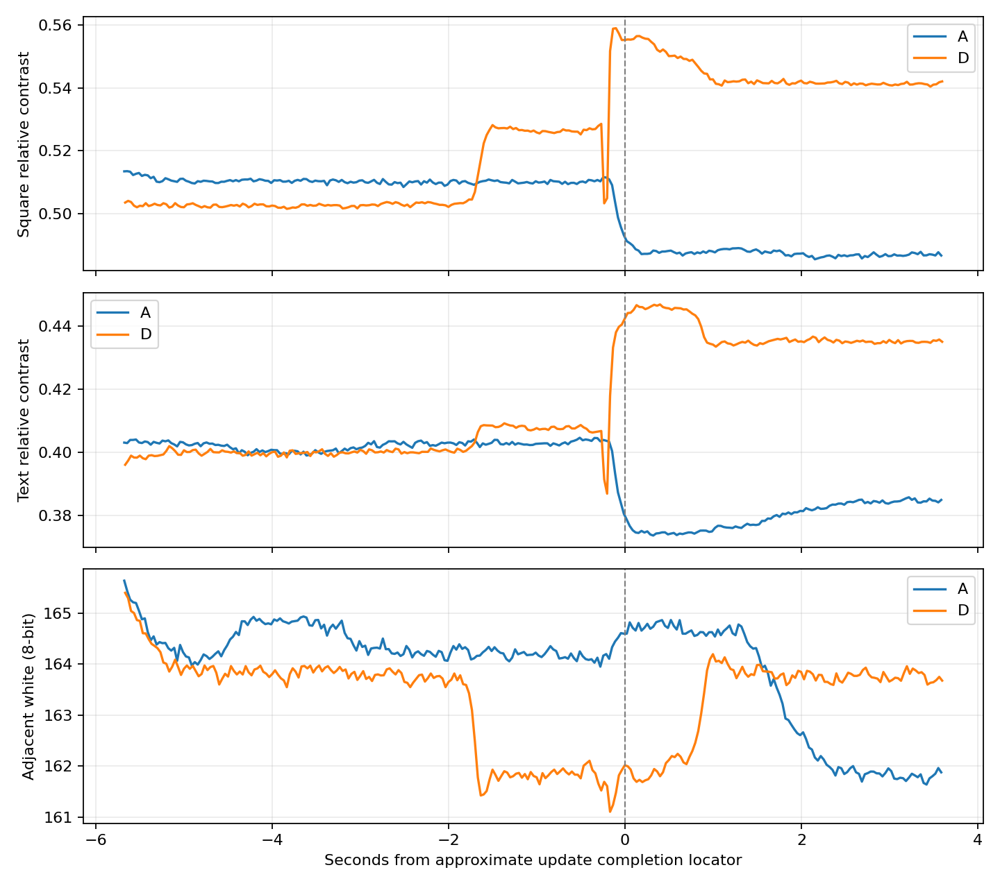

# SSD1677 Candidate D：単発A/D実機評価（2026-10-17）

**判定：CONDITIONAL。Dの更新後に黒化方向を動画で観測した。過渡的な薄まりは残り、Bより改善したとの確定や常用採用はしない。** A/D各1回で終了し、試験前のIntegrationへApplication-only復元済み。最終画面はShellで、ユーザーが「文字・白背景とも正常」と確認した。

## 実施範囲と実装

前回の[実装・Host・Build報告](m5paper-mono-black-hold-timing-d-20261017.md)完了後、ユーザーの「flash準備できました」と当日の撮影確認を受けて実施した。実装の追加変更・再ビルドは行っていない。A/D各単発、B/C再実行・D反復・Phase 3・Integrationへのmerge・pushなし。

| 項目 | 内容 |
|---|---|
| Branch | `experiment/papermono-black-hold-timing-d` |
| Worktree | `E:\ESP32\M5PapserMono-SolarOS\.research\black-hold-timing-d\worktree` |
| 基点 | `affd31987f81c7249473d64ae3957be199d6ed14` |
| 実装Commit | `e51d5a61db216227a30d514b18aa42c7368e90ab` |
| 書込み前レビューHEAD | `f901cba1fbcdce47064fd97c256ec51397f45630` |
| D Application SHA-256 | `5c8f0944e9b71b134f4aca5584c9e74ae9004cac2e06fab90a4fd10b55343fcd` |
| 最終Integration | `391925abff2d261d1d5856711aa0a1f101ac435a` |
| 最終Application SHA-256 | `278665c184653f06a403bd56713e7bf5073131bead0420b3fd2191fa54b12ef6` |

D LUT0は`2F F0 00 00 00 00 00 00 00 00`。Bの`−15V×2→HOLD×2→＋5V×6`を、`HOLD×2→−15V×2→＋5V×6`へ変更した。B/Dの110バイト比較ではoffset 0だけ異なる。LUT1〜4、タイミング、FR、Gate/Source/VCOM、通常fastest／tile／Dirty rows-dualのシーケンスは維持。通常fastestはBaselineで、Dは専用単発経路だけ。

Hostは実Driver・RAM/Shadow・単発guard・Baseline復帰失敗・R0/R2・Shell固定時刻・独立デコード2件がPASS。主要Host 19実行ファイルとSketch Python 9件もPASS。ESP-IDF 5.5.5／GCC 14.2.0のESP32-S3 compile/link成功、Application 3,458,960 B、OTA slot内、compiler/CMake warning/error各0。今回も成果物SHAとソース差分を確認し、準備時の検証結果を使用した。

## Flash・復元・保護

COM39、ESP32-S3、MAC `28:84:85:44:79:68`、Flash ID `0x184046`、16MiBを現物確認。実行／起動とも有効な`ota_0`（offset `0x10000`、size `0x700000`）。partitionとotadataを読み、現在の実用Applicationが上記Integration SHAと一致することを確認した。

新規16MiBバックアップと実行Applicationを保存し、排他的Flash lockと競合確認後にApplicationだけ書込み。D読戻しSHA一致。終了後も現物・slot・partitionを再確認し、バックアップApplicationだけを復元して読戻しSHA一致。**各書込みの直前・直後で**bootloader／partition table／NVS／FAT／otadata／PHYの内容が一致した。BLE bondや保存データの領域は消去・書込みしていない。実行中のNVS/FAT書込みまで含め、試験期間全体で不変だったという意味ではない。

復元後はUSB Shell、SolarOS 4.16.1 writerdeck、実行／起動ota_0 valid、SPI実効20MHz、`refresh=fastest`、既存startupのfastest＋tileを確認。Dirty Rectangle＋Sketch高速化＋TypeMouse長押し固定・キー反転を含む元のIntegrationである。startupは変更していない。新しいアプリ回帰試験は追加していない。

USBのsession照会ではLauncher起動を記録したが、ユーザーの最終目視はShellだった。画面を強制切替せず、そのShellの黒文字と白背景が正常であることを確認した。

ローカルバックアップ：`.research/black-hold-timing-d/archive/20261017-timing-d/`の`ota0-app-rollback.bin`と`full-flash-before.bin`。全FlashバックアップSHAは`5265eb0ad6ea5394274dd8f16404531c44a095a8a9ef53febeabb5a32e4303ec`。再復元が必要なら現物／slotを再確認してApplicationのみを使用し、16MiB全体を上書きしない。今回は追加復元不要。

証拠：[書込み](evidence/black-hold-timing-d-20261017/flash-summary.json)／[復元](evidence/black-hold-timing-d-20261017/restore-summary.json)／[最終目視](evidence/black-hold-timing-d-20261017/restore-visual.json)／[ローカル原記録hash](evidence/black-hold-timing-d-20261017/local-archive-provenance.json)。既存23 WorktreeのHEAD・statusと記録済み編集ファイルhashも不変：[監査](evidence/black-hold-timing-d-20261017/worktree-audit.json)。

## 更新手順・回数・速度

各条件で、OTP full白→OTP full共通画像→Baseline初回custom→完了5秒後T0→10秒後に測定1回→完了2秒後T1→確認・録画終了後OTP cleanup。白画面確認後、T0での確認待ちは挟まない。同一画像、20MHz、tile、rows-dual、AはBaseline LUT0、Dは候補LUT0。LUTの物理readbackはしていない。

| 指標 | A | D |
|---|---:|---:|
| 測定0x20 | 1 | 1 |
| 測定BUSY | 51.184 ms | 51.944 ms |
| 測定SPI API時間 | 62.073 ms | 62.434 ms |
| 測定Driver＋Baseline LUT復帰 | 168.486 ms | 170.004 ms |
| 初回custom総時間 | 541.274 ms | 541.995 ms |
| 初回custom完了→T0 | 5000.720 ms | 5000.028 ms |
| 初回custom完了→測定Driver開始 | 10005.037 ms | 10004.352 ms |
| 測定完了→T1 | 2000.200 ms | 2000.672 ms |
| 診断内0x20合計 | 8 | 8 |

診断内合計16回はOTP 3工程×各2回＋準備custom1回＋測定1回を各条件で実施した結果。Candidate Dの駆動は**1回だけ**。起動・通常Shell/LauncherのUI更新はこの診断カウンタ外で、全稼働期間の更新総数と混同しない。

測定時の03/04/2Cは各1回、32は各2回（測定LUT＋Baseline復帰）、20は各1回で一致。RAM転送は各144,000 B、全画面範囲。同一画像の強制更新用経路であり、この結果を通常WriterのDirty小領域更新時間とみなさない。SPI API時間は呼出し時間の合計で、純粋なwire時間や入力遅延ではない。Driver総時間には既存待機とBaseline LUT復帰を含む。

DはA比＋1.518ms、BUSY＋0.760msだった。単発差であり速度の統計的同等性は未判定。全phase err=0、timeout／復帰失敗／予想外の反転なし。cleanupはA 4473.906ms、D 4477.901msで正常終了。

証拠：[A計測](evidence/black-hold-timing-d-20261017/A-measurements.json)／[D計測](evidence/black-hold-timing-d-20261017/D-measurements.json)／[A原ログ](evidence/black-hold-timing-d-20261017/A-serial.log)／[D原ログ](evidence/black-hold-timing-d-20261017/D-serial.log)。

## 元動画の対応と解析方法

使用原本は`C:\Users\takec\Videos\AD`内の次の2本。file名・作成/更新日時・録画長・試験ログとの重なり・共通図形を照合し、日時順のA→Dと確定。原本を変更せず、解析終了時にもSHAを再照合した。時刻はJST。

| 条件／ファイル | 作成日時 | 録画長 | 測定完了ログ受信 |
|---|---|---:|---|
| A `20261017-135214.avi` | 10/17 13:52:14.246 | 170.04秒 | 13:53:34.460 |
| D `20261017-135558.avi` | 10/17 13:55:58.713 | 171.63秒 | 13:57:59.016 |

A SHA `92659de941c95cd64a9d29998e36544a4da9cf05b58564bee3a144404972e498`、D SHA `9869823f7dba73c01c33b8e720d4e012099ae2e96c10768cfdf68383e41634c1`。[対応詳細](evidence/black-hold-timing-d-20261017/video-time-verification.json)

Insta360 Link／Link Controller、3840×2160・30fps MJPEG。ユーザー申告で露出/Gain手動固定、focus19%、4100K、明るさ81%、contrast45%、彩度0%、sharpness26%、60Hz、線形露出曲線。露出/Gainの数値は不明、自然光混入の可能性あり、温度未測定。設定のreadbackはしていない。

前回Bと同じROI手法。A/Dの位置一致をプレビューとROI overlayで確認し、元解像度の同じ座標を使用した。黒四角ROIと近傍白、固定2行のT0文字maskと近傍白から`C=(白−黒)/白`を算出。文字maskは動画ごとにT0で固定（A 11,503画素、D 11,228画素）、T1で再選択しない。T0/T1マーカー後0／0.5／1秒の3標本のC中央値を主値とした。画素clipは各標本0%。

更新近傍はnative frameを全取得し、概算更新完了±1秒の最小と中心3frame移動中央値の最小を算出。動画PTSを保存した。マーカー位置はPC作成日時とUSB受信時刻からの概算で、校正した同期ではない。光学変化は概算完了より約0.2秒前にも見える。LUTの各相へ対応づけず、30fpsで短い白化を取り逃す可能性を残す。3標本／動画frameは独立した実験反復ではない。

## A/Dの光学結果

| ROI | A T0 C | A T1 C | A ΔC | D T0 C | D T1 C | D ΔC |
|---|---:|---:|---:|---:|---:|---:|
| 黒四角 | 0.51046 | 0.48663 | −2.38 pp | 0.50270 | 0.54194 | ＋3.92 pp |
| 固定文字 | 0.40274 | 0.38337 | −1.94 pp | 0.40002 | 0.43514 | ＋3.51 pp |

ΔCのD−Aは四角＋6.31pp／文字＋5.45pp。ただしD開始CはAより四角0.78pp／文字0.27pp低く、完全に同じ光学状態ではない。**映像上の相対コントラストはDで黒化方向、Aで薄まり方向。厳密な測光値や波形の因果効果量として扱わない。**

| 過渡指標（C／pp） | A四角 | A文字 | D四角 | D文字 |
|---|---:|---:|---:|---:|
| raw最小C | 0.48654 | 0.37360 | 0.50321 | 0.38686 |
| 3frame中央値最小C | 0.48709 | 0.37392 | 0.50485 | 0.39140 |
| T0−raw最小 | 2.39 | 2.91 | −0.05 | 1.32 |
| T0−3frame最小 | 2.34 | 2.88 | −0.21 | 0.86 |
| T1−raw最小（回復量） | 0.01 | 0.98 | 3.87 | 4.83 |
| T1−3frame最小（回復量） | −0.05 | 0.94 | 3.71 | 4.37 |

**D四角のT0比最小が負でも「白化なし」ではない。** Dでは概算更新の約1.6秒前に白基準が低下し、四角Cが上がる段差を観測した。更新直前の局所基準からは一時的な谷がある。

前回Bと同じ補助窓（概算完了−0.75〜−0.5秒、＋0.2〜＋0.45秒）で確認すると、Dは直前Cからraw谷まで四角**2.29pp**／文字**2.09pp**低下。3frame谷では2.13／1.64pp低下。その後の窓のCは直前より＋2.78／＋3.84ppで、同じ窓間の白変化は−0.026%／＋0.046%と小さい。更新に伴う黒化方向を支持するが、補助窓は事後分析であり主T0/T1を置換しない。

白基準T0→T1はA四角−1.43%／文字−1.50%、D−0.12%／−0.10%。Dの最終差が小さくても途中の照明変動がないわけではない。Dでは更新前の段差前後で白が約−1.14%／−0.90%、Cが＋2.33／＋0.73pp変化している。原因は未確認で、自然光・光学条件等を分離できない。Dの最終＋3.92／＋3.51ppを全て候補駆動だけの作用と断定しない。

ユーザー目視はA/Dとも「濃さほぼ不変・背景正常・目立つちらつきなし」。動画の小さな濃度差と目視評価を区別して記録する。[A目視](evidence/black-hold-timing-d-20261017/A-visual.json)／[D目視](evidence/black-hold-timing-d-20261017/D-visual.json)

上図横軸0は概算更新完了。オレンジの更新前段差も表示しており、波形だけの変化とは扱わない。[元計測・native時系列](evidence/black-hold-timing-d-20261017/roi-results.json)／[局所窓感度確認](evidence/black-hold-timing-d-20261017/near-event-check.json)／[A ROI](evidence/black-hold-timing-d-20261017/A_roi-overlay.png)／[D ROI](evidence/black-hold-timing-d-20261017/D_roi-overlay.png)

## 前回Bとの補助比較・判断

前回の撮り直しB `Videos\AB\20261017-125153.avi`（SHA `f38c984a9c76ce8b79a01fd2b216ab58b1334d754a11060a16f9b8450c8158f4`）と比較。Bを再実行していない。

| 指標 | 前回B 四角／文字 | 今回D 四角／文字 |
|---|---:|---:|
| T0→T1 ΔC | ＋4.23／＋2.84 pp | ＋3.92／＋3.51 pp |
| raw谷のT0比低下 | 6.26／5.65 pp | −0.05／1.32 pp |
| 3frame谷のT0比低下 | 1.91／3.28 pp | −0.21／0.86 pp |
| raw谷の局所直前比低下 | 6.19／5.05 pp | 2.29／2.09 pp |
| BUSY | 51.125 ms | 51.944 ms |

**黒化方向を維持し、記録された過渡の谷はBより小さい傾向。ただし改善確定はCONDITIONAL。** 同時のB/D対照ではなく、温度不明、開始光学状態・自然光の差、30fps・rolling shutter・同期誤差、今回Dの更新前段差がある。前回Bの四角T0白171.09に対して今回D163.91で約4.2%低く、同じカメラ申告設定でも入射光が同じとは限らない。[前回B補助データ](evidence/black-hold-timing-d-20261017/previous-B-auxiliary.json)

単発の正常駆動と速度維持の方向は確認したが、反復安定性、実効DC、寿命、通常アプリでの濃度保持は未確認。実用統合は推奨確定せず、候補として保持する。次に進む場合の優先事項は光学外乱・時間同期を改善したB/D比較の別途計画であり、本タスクから自動実行しない。現在の実機はD Trialではなく、元のIntegrationで終了している。
