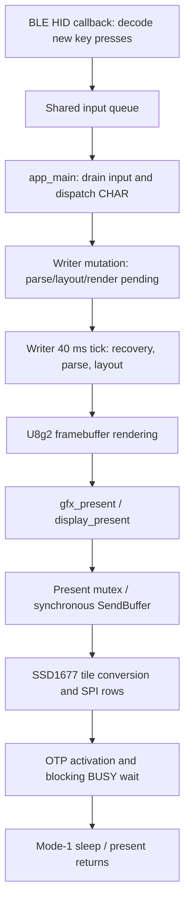

# PaperMono Writer display pipeline profiling

## Architecture recorded before instrumentation (2026-10-07)

Base SolarOS revision is `1ba98726e0c52f5147c8a565522a94d7b67b0291`, with
the preceding uncommitted PaperMono port and OTP fast-refresh implementation.
The previous acceptance image is retained in `build/papermono-writerdeck/`.

Code authorities: `solar_os_ble_keyboard.c:handle_keyboard_report`,
`main.c:dispatch_input_sources/dispatch_app_tick`,
`solar_os_writer.c:writer_event/writer_update_document/writer_render`,
`solar_os_gfx.c:solar_os_gfx_present`, `solar_os_display.c:solar_os_display_present`,
and `epd_ssd1677.c:ssd1677_write_plane/ssd1677_papermono_refresh`.

Writer CHAR handling mutates state and sets pending booleans, without immediately
rendering. The main loop drains input before and after app ticks. Pending input
therefore batches into the next Writer tick (40 ms requested interval), with
one render/present per pending tick. Present has a mutex, **no frame queue or
display worker**. The synchronous U8g2 callback performs the complete refresh
on the caller's task. Writer cannot process new events while it is blocked;
BLE reception can continue on its callback context and enqueue further keys.
For this build, the HID callback runs on the `ble_hid_events` worker (priority 4),
fed by NimBLE notifications. Writer, rendering and synchronous present run on
`app_main`'s main task; this is not the NimBLE host task.

The display target owns the U8g2 buffer. Session contexts select a target/gfx
object. Rendering uses U8g2 draw calls; the SSD1677 driver converts its vertical
tile bytes to controller rows during each write. Mono gfx has a dirty boolean,
Writer has parse/layout/render pending booleans, and the driver has a whole-frame
shadow. These do not propagate dirty rectangles. PaperMono keeps full-frame OTP
fast differential updates, baseline fallback, manual cleanup and blink disabled.

The previous button observations are **not established implementation bugs**:
physical hold duration was not measured and the user reports likely operation
differences. This phase does not investigate or change KEY architecture,
debounce or thresholds. BLE connection behavior is also outside this phase;
only the requested input timestamp instrumentation may touch that path.

## Measurements and optimization

The initial measurements and chosen optimizations are described below. BLE trial
tables are completed from captured timestamps, not inferred from code alone.

Instrumentation is opt-in: `log level debug`, `log sink cdc on`,
`display mode display0 timing=on`, then `log follow debug` on the USB shell.
The existing ESP log compile/runtime filtering does not mirror every debug tag;
follow drains the SolarOS debug ring. Exit follow with Ctrl+C before commands.
Restore info level, CDC sink off and timing
off afterwards. Writer diagnostics record input/mutation, render start/end
(including clear time), present return and slow ticks with document/recovery
duration/error. Display diagnostics record request, execution start and return.
SSD1677 records each write and activation boundary plus accumulated row conversion
and SPI polling durations. No per-pixel or per-row log output is generated.

Writer frame IDs identify the next render batch; IDs restart when a Writer
instance starts. Synchronous nesting and timestamps join display/driver spans
to that render. BLE new-press diagnostics include translated keys and microsecond
timestamps on `ble_hid_events`; report-to-input association preserves key order.
These timestamps measure report handling, not the physical switch or radio edge.
All records use `esp_timer_get_time()`. Render/display summaries are emitted
after present returns, so file line order is not event order.

Conversion and SPI are interleaved per row. Conversion start/end delimit the
overall span, while `convert_us` sums conversion-only intervals; `spi_us` sums
the polling call intervals. Both are wall time and may include preemption.
Remaining write time covers window commands, loop bookkeeping and timestamp
overhead. Activation readiness retains the existing sampled BUSY wait policy.

Run `python scripts/analyze_display_pipeline.py capture.log --csv frames.csv`
to correlate frames and produce stage summaries. The parser removes duplicate
ESP/CDC messages and excludes incomplete frames. Use separate captures or markers
for the requested five single-character, five short-burst, three long-burst and
edit/scroll trials; batch completion includes all frames, not just the first.

## Preparation validation

- Normal PaperMono writerdeck instrumentation build succeeded with ESP-IDF
  5.5.5 (240.53 s). Saved separately in `build/papermono-pipeline-profile/`;
  firmware SHA256:
  `e25fe7b0a144bb4ee2d7032e6f2800584232bbe66763282d5ca492b34f088209`.
- SSD1677, display layout, Writer buffer/files, document layout, BLE HID and input
  host tests passed. SSD1677 timing tests inject a known SPI delay and verify
  SPI accumulation/boundaries without changing register/data regression coverage.
- Parser tests cover batched inputs, duplicate ESP/CDC output, stage arithmetic,
  unchanged-frame skips, unknown report timestamps and incomplete captures.
- Final Python suite after optimization: 541 tests, 537 passed and 4 skipped
  (WSL, 15.398 s).
- Bringup writerdeck instrumentation build succeeded (123.82 s), saved in
  `build/papermono-pipeline-profile-bringup/` and not flashed. Firmware SHA256:
  `ac9a89e5f14aa2d5cce712cb5e20fc7b31fc8889ef3204ce6be2bb12da04bb80`.
- No KEY policy/debounce/threshold change and no dirty rectangle. Optimization
  was chosen after physical measurements. BLE change is diagnostic logging of
  new key presses.
- Initial device discovery did not find COM39. Only COM1/15/16 were present;
  later COM47 (the ZMK device) appeared. The user subsequently connected both
  devices. Normal instrumentation firmware
  was flashed to COM39 with application hash verification; storage and NVS were
  preserved. The first esptool attempt stopped on host cp932 progress-output
  encoding; the immediate UTF-8 retry completed and verified the image.

## First physical findings (before optimization)

While the requested BLE reconnect/pairing preparation was in progress, two USB
`input emit` characters verified the Writer/display instrumentation. These are
**synthetic local inputs, not the required BLE trial series**.

For the first `a`, Writer input-to-render was 38,130 us, document update 367 us,
render 169,961 us (clear 121,885 us), present scheduling 502 us, conversion
31,023 us, SPI polling 48,195 us, activation 559,942 us, and input-to-return
1,087,733 us. The first idle recovery save succeeded in a separate 402,401 us
tick. Evidence: `pipeline-instrumentation-smoke.log` plus
`pipeline-smoke-history.log`; `pipeline-smoke-combined.log`/CSV join the records.

After synthetic `b`, the second checkpoint failed and retried every Writer tick.
In a 45-second capture there were **134 failed recovery attempts**, **135 renders
and presents**, but only **two panel refreshes** (the edit and the first error
message); subsequent identical frames were skipped correctly by SSD1677.
Recovery median was 245,177 us, maximum 302,241 us. These repeated synchronous
flash saves explain the previously observed idle tick overruns and steal most
of the main-loop runtime despite no further user input. They are not a present
queue backlog or repeated waveform activations.

The code path was `write(temp) -> rename(temp, existing recovery)`.
ESP-IDF 5.5.5 `components/fatfs/vfs/vfs_fat.c:vfs_fat_rename` delegates directly to
FatFs `f_rename`; existing destination files produce `FR_EXIST`/`EEXIST`.
Metadata used the same unsafe replacement assumption. Writer's normal document
save already uses `solar_os_writer_safe_replace`, which stages, vacates the
destination with a backup, verifies the replacement and restores on failure.
That existing generic helper is the first optimization target for checkpoints.
No new display scheduling or dirty-region abstraction is required for this fix.

The implemented Writer change routes recovery and metadata through that helper,
backs off a failed checkpoint for another 2 s idle interval, resets retry state
on edits, and avoids requesting a render when the error message is unchanged.
Host coverage emulates FAT's no-overwrite rename contract and tests repeated
replacement, failure preservation, retry timing and millisecond wraparound.
Post-change physical confirmation: the two synthetic edits both checkpointed
successfully (`recovery_err=0`), and `/.writer/d587764f.recovery` contained `ab`.
No additional idle render/present occurred in the 40-second capture. The retained
old test files were not deleted. Successful safe replacement is still synchronous:
these two saves took 464,763 and 728,457 us; avoiding the failure loop does not
make flash writes asynchronous.

The second optimization is generic solid monochrome clearing. A complete,
byte-aligned framebuffer can be filled with `memset` independently of rotation.
GRAY/dither, padded, partial-page and indexed-buffer paths retain their existing
handling. The helper checks dimensions and buffer size; gfx preserves polarity,
draw state and dirty state. No PaperMono branch was added to Writer. Tests compare
all four rotations, both polarities and black/white against independent pixel
rendering with canaries; existing 12,288 raster cases also pass.

The optimized normal image built in 32.90 s and was flashed with application hash
verification; SHA256 `2fb1981b08f48b9bc0362b77e45003ee79f36bcfc909ea2b7e8e7989fd8f638e`.
Artifacts are saved in `build/papermono-pipeline-optimized/`. Optimized bringup
also built (120.52 s), saved in `build/papermono-pipeline-optimized-bringup/`,
SHA256 `c1b44f80ca79f6c84542381fbc5ff1fff5604a4b8b8ed9a48dbc678597134401`,
and was not flashed. Final SSD1677, display layout, Writer buffer/files, document
layout, BLE HID, input, gfx raster, PaperMono power and FT6336 host tests pass.

BLE logs are retained separately. One automatic connection eventually succeeded
at 304.604 s after repeated HID-open failures. The subsequent requested BT_CLR
was followed by standard USB `ble pair`; three pairing attempts failed. No BLE
connection logic was changed or diagnosed further in this display phase.
After the optimized-image reboot, another connection failed. Following the user's
next BT_CLR, standard `ble pair` succeeded at 170.427 s and remembered one keyboard;
the physical BLE input trials then started. Captures retain both failures and
success without altering BLE connection policy.

## Initial optimized BLE samples (series still in progress)

The first five `a` presses produced five input batches, five renders, five
presents and five successful fast updates. The user confirmed no missing glyphs
or ghosting. The final two reports arrived during the preceding update, despite
the requested eight-second spacing; their 281/541 ms reception-to-input delays
are retained as queue evidence, not counted as strictly isolated trials.
Two additional isolated presses and five `abcde` bursts have been requested.

| Stage, first five one-character frames | Median | Min–max |
| --- | ---: | ---: |
| Writer input to render start | 11.214 ms | 10.392–40.342 ms |
| Document parse/layout | 0.390 ms | 0.383–0.404 ms |
| Render | 1.610 ms | 1.515–1.910 ms |
| Full buffer clear (part of render) | 0.088 ms | 0.087–0.089 ms |
| Present request to execution | 0.026 ms | 0.026–0.027 ms |
| Conversion sum | 30.915 ms | 30.583–32.584 ms |
| SPI polling sum | 48.669 ms | 48.449–50.593 ms |
| Activation to sampled BUSY ready | 559.613 ms | 559.088–559.881 ms |
| Driver fast refresh | 873.767 ms | 873.067–874.611 ms |
| Writer input to present return | 889.277 ms | 888.745–919.203 ms |
| HID report handling to present return | 925.512 ms | 890.244–1429.599 ms |

No 1.35-second **driver** update or 443 ms RAM-write outlier occurred in these
five frames. The 1.430 s report-to-return sample is a different metric, explained
by a report queued behind the previous synchronous refresh. It must not be called
the old RAM-transfer outlier. Evidence: `pipeline-optimized-single.log` and its
generated frames/ticks CSV under `.research/hardware/`.

The pre-change synthetic first edit rendered in 169.961 ms, including 121.885 ms
clear; these BLE frames rendered in 1.610 ms median with 0.088 ms clear. This is
evidence of removal of the pixel-loop clear, **not a controlled BLE before/after
latency experiment**: input sources, shell activity and cache state differ.
The post-change synthetic shell edits also showed 35–39 ms clear and 75–100 ms
document processing, so those shell-driven samples cannot substitute for BLE
typing latency. Requested short/long burst, edit and scrolling measurements are
not complete yet and no results are claimed for them.

The provisional ROI of rectangular RAM transfer is bounded by approximately
31 ms conversion + 49 ms SPI polling per frame (about 9% of the 874 ms driver
duration even if all of it disappeared). Activation alone is 560 ms, and other
reset/wake/power/wait stages consume the remaining driver time. The implemented
generic rendering and recovery fixes therefore precede dirty rectangles. No
rectangular RAM transfer or rectangular physical waveform was implemented.

## Requested BLE series: isolated, short and long input

Five genuinely isolated `a` trials are frames 4–6 in the single capture plus
frames 9–10 in the short capture. Two initially overlapping `a` frames remain
in the raw evidence but are excluded from this isolated table. All five `abcde`
trials and all three 20-digit trials match the expected key sequences exactly.
The user confirmed correct output without missing text, ordering errors or
display defects. Captures: `pipeline-optimized-single.log`,
`pipeline-optimized-short.log`, `pipeline-optimized-long.log`, with frames/ticks
and short/long trials CSV in `.research/hardware/`.

| Per-frame stage median, ms | Isolated a (5 frames) | abcde (16 frames) | 20 digits (17 frames) |
| --- | ---: | ---: | ---: |
| Report handling → Writer input | 1.439 | 694.983 | 758.266 |
| Writer input → render start | 20.334 | 10.538 | 11.519 |
| Document parse/layout | 0.385 | 0.402 | 0.424 |
| Render, including clear | 1.607 | 2.068 | 3.590 |
| Clear | 0.088 | 0.088 | 0.088 |
| Present request → execution | 0.026 | 0.027 | 0.026 |
| Conversion sum | 30.871 | 30.921 | 31.051 |
| SPI polling sum | 48.669 | 48.748 | 48.842 |
| Activation → sampled BUSY ready | 559.860 | 559.356 | 559.781 |
| Driver fast refresh | 873.767 | 872.663 | 873.456 |
| Writer input → this frame's completion | 897.329 | 888.502 | 891.374 |

Stage medians are not additive, and parse/layout is contained in input-to-render.
For bursts, the per-frame input is the first key in that frame's batch. Queue
delay is reception-to-Writer dispatch on the main task, not a display-frame queue.
Report timestamps start at HID report handling, not physical switch or radio arrival.
Completion means the synchronous present returns; optical ink motion was not
timed. BUSY is sampled by the existing driver policy, and present includes the
existing approximately 100 ms post-ready sleep sequence.

| Complete trial | Trials | Updates per trial | First report → all text, median (range) | Last report → all text, median (range) |
| --- | ---: | ---: | ---: | ---: |
| a | 5 | 1 | 898.768 ms (878.918–925.512) | same |
| abcde | 5 | 3 (3–4) | 2671.066 ms (2657.856–3581.985) | 1627.790 ms (1617.072–1726.081) |
| 20 digits | 3 | 6 (5–6) | 5343.818 ms (4512.622–5368.722) | 1368.896 ms (1167.724–1453.799) |

Burst totals include the user's typing duration. Median stage sums per complete
five-character trial: document 1.188, render 6.838, scheduling 0.080, conversion
93.384, SPI 146.291, activation 1678.369 and driver refresh 2619.415 ms. For a
20-digit trial: document 2.489, render 19.953, scheduling 0.157, conversion
186.034, SPI 291.980, activation 3357.970 and refresh 5240.814 ms. These sum
individual frames rather than misreporting the first update as burst completion.

The five short bursts total 25 inputs / 16 renders / 16 presents / 16 physical
fast updates. The three long bursts total 60 / 17 / 17 / 17. Buffered keys batch
at the next tick; the next batch commonly starts about 10–12 ms after dispatch.
There is no separately queued/coalesced display generation. One isolated input
causes one render, one present and one physical update; no idle cursor animation
or checkpoint-induced redundant updates occur after the fix. Unchanged frames
are still skipped by the driver, as demonstrated in the pre-fix failure loop.

Across the first 40 post-optimization BLE fast frames, the driver maximum is
877.204 ms. The old 1.354944 s / 442.771 ms RAM-write outlier did not recur;
its cause is not inferred. The earlier synthetic second edit's 1068.613 ms
refresh spent extra time before RAM write; its RAM write was only 79.510 ms,
also not the previous RAM-transfer outlier.

The current per-frame bottleneck order is activation (~560 ms), other driver
reset/wake/post-ready stages (~234 ms), conversion+SPI (~80 ms), input/tick
cadence (~1–50 ms), rendering (~2–4 ms), and present scheduling (~0.03 ms).
During continuous typing, waiting for the preceding synchronous frame adds up
to ~0.85 s before Writer can accept a report. Idle checkpoint saves remain
~0.72 s synchronous stalls, but now occur once per settled edit group rather
than continuously retrying at ~0.25 s per tick. The main loop returned to
approximately 100 loops/s while idle. Moving display execution off the main
task with immutable frame snapshots and a latest-pending-frame policy is the
largest remaining software opportunity for input service; it does not shorten
the panel's waveform. Checkpoint I/O scheduling is another measured target.
Neither concurrency redesign was silently added in this phase.
