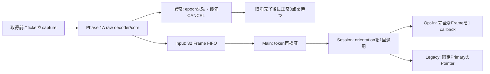

# PaperMono Type/Mouse Phase 1B-1 — Complete Frame統合

2026-10-14。新経路のHost実装・検証とPaperMono向けESP32-S3 compile/linkを完了した。実機入力経路の切替、USB操作、flashは行っていない。追加Python回帰には分岐元から存在する1件のFAILがあり、全テストPASSという判定にはしていない。

## A. Git状態・変更範囲

| 項目 | 結果 |
|---|---|
| branch | `experiment/papermono-type-mouse-phase1b1` |
| 実装commit | `8563b8f241b4874aa5f8fcbf014d10223995cc12` |
| 分岐元 | Phase 1A最終HEAD `254abcf1bd9ec83755f377d2852bc482d101486f` |
| 継承した主要commit | `c08889e8f9e33fde77ce928c4131d9f607315d28`、Phase 1A報告書とLF指定の後続commitも含む |
| worktree | `E:\ESP32\M5PapserMono-SolarOS\.research\type-mouse-phase1b1\worktree` |
| 最終HEAD | 本報告書を収録する後続commit。branch上で `git rev-parse HEAD` から取得できる |

変更ファイル：

- `src/services/solar_os_input.{c,h}`、新規 `solar_os_input_touch.inc`：既存InputへのFrame FIFO、token、全離指gate、優先CANCELの追加。
- `src/services/solar_os_sessions.{c,h}`、新規 `solar_os_sessions_touch.{c,h}`、`solar_os_sessions_touch_adapter.inc`：recipient登録、取消、固定token配送、legacy投影、Session lifetimeの管理。
- `src/solar_os.h`：Event型とApp opt-in flag、借用Frame参照を追加。
- `src/main.c`：既存入力drainへ新経路を追加。停止/復帰境界の取消。
- `packages/solar_os_packages.toml`：pure core、decoder、Session補助をcore runtimeへ登録。decoderはdriver packageから移動し、FT6336を使わない構成でもInputのリンク依存を満たす。
- `tests/host/input_touch_service_test.c`、`input_touch_adapter_test.c`、`sketch_touch_projection_test.c`、`run_touch_phase1b1.sh`、`Makefile`、`.gitattributes`。
- 本報告書。

元Sketch worktreeは `experiment/papermono-sketch-latency-measurement / 31abd6db` のまま、既存 `?? .vscode/` を維持。Phase 1A worktreeは変更なし。旧WriterDeckの既存 `.vscode/extensions.json` と `include/WriterDeckBleUtils.h` の差分も維持した。stash/reset/clean/強制checkoutは使用していない。

## B. 実装アーキテクチャ



新しい独立Inputタスクは作らず、既存 `input_sources`、`input_lock`、sourceのready/close管理を再利用する。`.inc` は `solar_os_input.c` の一部としてコンパイルされる。Session補助は既存Sessionsのapplication-task adapterであり、producerからSession配列やAppを直接参照しない。

### Token・sequence・lifetime

`capture()` は取得の直前に毎回呼ぶ。具体的なdisplay targetの登録済みrecipientをInput lock内で確定し、source epoch、recipient generation、次のsequenceをticketへ返す。取得中にclose/focus変更が起きても、投入時に古いticketを拒否する。配送時に現在のforegroundへ宛先を付け替えない。

epochとrecipient generationはboot内の単調64bit token。source IDは既存uint8のままでも、close/reopenやslot再利用をtokenで区別する。tokenはリセット・wrapして再利用せず、上限到達時は新規入場を拒否する。source sequenceの上限はepochを失効させCANCELへ移行する。

投入sequenceは `ticket.next_sequence` と直前の値+1の両方に一致すること、timestampは逆行しないことを要求する。CANCEL後は新epochでsequenceを再開する。gateによる抑止を含む取得sequenceなので、Consumerが最初に見るsequenceが1とは限らない。配送で要求するのは同epoch内の単調増加であり、既に完了したFrameの再配送は拒否する。

Sessionには追加のboot内lifetimeを持たせた。recipient tokenの世代に加え、取消callback中に同じSession枠・同じApp descriptorが再利用された場合も旧contextのcleanup/resumeを実行しない。Session ID 0も有効recipientとして扱う。legacy foregroundのownerは255。

### FIFO・CANCEL・gate

normal FIFOは32 Frame、別枠のCANCELは最大8 source分。どちらも固定長で毎Frameの動的確保はない。Hostではnormal queue 2,816 bytes、source state 1,344 bytes、Input consumer registry 256 bytes。これらは外部RAM BSS指定。targetのABI/sizeはHostと同一とは限らない。

旧Workerの10ms待機を前提にした容量の目安は単一sourceで約320ms分。ただし新readerの実取得周期やMainの応答時間は未測定で、無欠落の時間保証ではない。複数sourceで容量を共有する。Mainは1回の巡回で最大32+8件を扱う。静止Frameも0点Frameもnormal FIFOへ入れ、latest-only/MOVE coalescingは導入していない。

overflow時は投入単位のFrame全体を拒否し、対象sourceのepochと接触状態を失効させる。古いqueue項目やMainが既に読み出したコピーはepoch/generationで失効する。別sourceのFrameを強制evictしない。CANCELはnormal FIFOの空きに依存せず先に読み出す。CANCELは新しい失効epochを通知する制御イベントで、Consumerは旧epochとの不一致だけを理由に取消を無視してはならない。

read後には必ず `finish()` が必要。CANCELの通知を完了しなかった場合はpendingを保持して再試行する。取消のdequeueだけで再ARMしない。取消処理後に正常0点Frameを取得するまで、残存接触とRESYNCEDの非空snapshotを配送しない。正常0点でARMし、その後の新規接触から通常配送する。初回入場も0点確認を要求するが、旧接触が存在しない初回にはCANCEL通知を作らない。

pure coreはID対応と状態比較を担当する。Inputはepoch、gate、FIFOと取消完了を担当し、coreの比較edgeからCLICK等を生成しない。失効時にcoreを初期化しても、Input側のgateを通過できないため、残存接触を新PRESSとして投影しない。

### Session境界・legacy

focus変更、Session/Appのsuspend/stop、電源停止/復帰、source ready=false/close、Input resetで失効する。live Appの取消はstop/suspendとcold-state解放より前に同期通知する。通知中はApp要求を再帰的に処理しない。既に終了したrecipientは登録解除によってqueue/controlを破棄し、callbackしない。

opt-inとPointer flagを両方持つAppでも新経路はFrameを優先し、同じFrameのPointerを二重配送しない。Frame capabilityのsourceから旧Pointer FIFOへの書込みも拒否する。既存Workerのsourceにはそのcapabilityを付けていないため、旧経路の書込みは変わらない。

legacy投影は最初のPrimary IDを固定する。secondaryの追加/移動/先離しは新しいpointerを生成しない。Primary先離しではRELEASEし、残ったsecondaryを昇格させない。完全離指後だけ次のPrimaryを選ぶ。初回から同時2点で先着順を確定できない場合は、ID順の先頭を決定的に選ぶ。

legacy CANCELは `TOUCH_CANCEL` で通知し、RELEASEを作らない。既存SketchはこのEventを知らないため、Session adapterがその既存suspend/resume callbackを釣り合う形で呼んでstrokeを解放する。Frame sourceごとのPrimary状態は独立し、あるsourceのCANCELで別sourceのPrimaryを消さない。任意のlegacy Appにgesture解放処理を追加したわけではなく、未知のAppの取消時の動作は、そのEvent/lifecycle契約も確認する必要がある。

### 座標

Raw座標はPhase 1Aの12bit X/Y。Inputは各contactへ既存calibrationを一度適用し、normal Frameに正規化座標を保存する。Session dispatchはdisplayのnative width/heightとprofile orientationを使い、既存pointer orientation APIで両contactを同じように一度変換する。legacy Pointerはその変換済みFrameから作り、旧Mainのpointer再回転関数を通さない。範囲外座標・不正角度は配送せず取消へ移行する。

## C. Event API・所有権

| API / 型 | 契約 |
|---|---|
| `SOLAR_OS_INPUT_CAP_TOUCH_FRAMES` | 新しいproducer経路の明示capability。既存FT6336 sourceには未設定 |
| `solar_os_input_touch_ticket_t` | 取得前のsource/recipient/epoch/generation/next_sequence/targetの固定契約 |
| `solar_os_input_touch_frame_t` | source、recipient、epoch、generation、sequence、monotonic timestamp、target、SAMPLE/CANCEL、cancel reason、最大2点のsnapshot |
| `solar_os_touch_snapshot_t` | Phase 1A coreのcontact表現を再利用。IDをslot indexへ置換しない |
| `SOLAR_OS_EVENT_TOUCH_FRAME` | opt-in Appへnormal FrameとCANCELを渡す |
| `SOLAR_OS_APP_FLAG_TOUCH_FRAMES` | Frame受信のopt-in |
| `SOLAR_OS_EVENT_TOUCH_CANCEL` | legacy Pointer Appの取消。通常RELEASEとは別 |
| `touch_consumer_register/cancel/unregister` | Inputの低レベル登録API。Session routeと対でapplication taskが所有する |
| `sessions_touch_bind/unbind` | route登録。解除はAppのcold-state解放前。同じ登録はidempotent |
| `touch_capture/write_touch_frame` | 取得ごとにcapture。NULL rawは読取失敗。INVALID/UNCERTAINはCANCEL。失効後の旧ticketは再利用しない |
| `read_touch_frame/frame_valid/finish` | Mainの逐次drain。読み出し後に再検証し、必ず完了/未配送を通知する |
| `touch_stats` | Enqueued、Delivered、Overflow、Cancel、Stale discard、high-watermark、現在queue数 |

InputはFrameを値コピーして保管し、callerのraw bufferを所有しない。normal/CANCELのreadも値コピー。App callbackの `event->data.touch_frame` は**callback中だけ有効なconst参照**であり、保持するAppは参照先Frameをコピーする。`solar_os_event_t` をコピーするだけでは借用参照の寿命を延長できない。Appへqueue内部やraw bufferのpointerは渡さない。

Event enumは末尾追加し、既存0〜6を維持した。App/Pointerの既存flag/構造体は変更なし。Eventを4byte alignmentで保持し、HostとESP32-S3のコンパイル時assertで `sizeof(event)=40`、`offsetof(data)=4`、`sizeof(pointer)=36` を確認。既存Eventコピーとqueue item sizeの増大を避けた。新Frame APIを使うAppは新しいヘッダと借用契約で実装する必要がある。既存Native Appを実機で新たに評価したという主張ではない。

専用Frame基盤の追加initタスクはない。既存 `solar_os_input_init()` のresetで新経路も失効し、source close・consumer unregisterで関連状態を解放する。tokenカウンタはboot中に初期化し直さない。

## D. 試験・build結果

WSL Ubuntu-24.04、C11、`-Wall -Wextra -Werror`。専用worktreeで実行：

```powershell
wsl -d Ubuntu-24.04 -- sh /mnt/e/ESP32/M5PapserMono-SolarOS/.research/type-mouse-phase1b1/worktree/tests/host/run_touch_phase1b1.sh
wsl -d Ubuntu-24.04 -- sh /mnt/e/ESP32/M5PapserMono-SolarOS/.research/type-mouse-phase1b1/worktree/tests/host/run_touch_phase1b1.sh --sanitize
```

| Host executable | 結果 |
|---|---|
| `input_touch_service_test` | 新規26ケース PASS：0/1/2点、静止/空Frame、順序、overflow、priority CANCEL、完了待ち、gate、source再利用、recipient再利用/ID 0、取得中/配送中切替、sequence/time逆行・上限、calibration、4方向の両点、legacy投影、source間の取消独立、capacity/wrap |
| `input_touch_adapter_test` | 新規7ケース PASS：実際のSession adapterのroute/context、停止前取消、legacy cleanup、取消中停止/同枠再利用、suspend/resume、回転 |
| `sketch_touch_projection_test` | PASS：実際のprojectionと既存Sketch fixture。線追加、Primary先離し、secondary非昇格、取消時のstroke解放、Canvas保持 |
| Phase 1A `ft6336_frame_test / input_touch_core_test / ft6336_test` | 16+11+6ケース PASS。ID/eventの1,024組も継承 |
| Phase 1A `ft6336_lifecycle_test` | PASS。旧serviceは6バイトreadのまま |
| `input_test` | PASS。旧キー・Pointer・source・calibrationの既存fixture |

新規の名前付き33ケース＋Phase 1Aの33ケース＝**66ケース、FAIL 0**、および上表のsuiteがPASS。runnerの8 executableは通常とASan/UBSanの両方でPASSし、sanitizer診断なし。最後に通常ビルドへ戻して再確認した。

追加の既存Sketch回帰も以下をmake/実行し、5 executableがPASS：`sketch_canvas_test`、`sketch_lifecycle_test`、`sketch_scale140_lifecycle_test`、`sketch_legacy_lifecycle_test`、`sketch_trace_core_test`。

試験は実際のInput/queue/core/Session projectionのsourceをリンクまたはincludeしている。Session adapter fixtureは実際の `.inc` を実行し、context・display・App lifecycle境界をHost peripheralとして模擬する。大きなSessions本体の全起動/描画処理をHostで丸ごと実行したわけではない。Sketch projection fixtureはtransportだけstubで、queue/epochは別のreal Input fixtureで検証している。

Pythonはworktree rootで `PYTHONDONTWRITEBYTECODE=1 python3 -m unittest discover -s tests -p <ファイル>` を実行。

| Python suite | 件数 / 結果 |
|---|---|
| `test_board_manifests.py` | 33 PASS |
| `test_flavor_packages.py` | 42 PASS |
| `test_ssh_session_policy.py` | 3 PASS |
| `test_input_actions.py` | 8 PASS |
| `test_sketch_trace.py` | 8 PASS |
| `test_foreground_app_state.py` | 3 PASS、1 FAIL |

合計98件中97 PASS / 1 FAIL。FAILは `src/apps/solar_os_sketch.c:25` の既存 `static uint32_t sketch_canvas_version` に対するstatic-state policy検査。Phase 1A worktree `254abcf1` で同じコマンドを実行して同一failureを確認した。今回そのsourceには差分がなく、Sketch Phase 2を保護する指示に従い変更していない。このfailureをPASS/skipへ書き換えていない。

### ESP32-S3 compile/link

専用worktree自身の `.pio/build` を使用。元のbuild directoryや設定を再生成していない。PowerShellで次の環境を指定し、既存 `.pio-core/penv/Scripts/python.exe -m platformio run -e esp32_s3_devkitc1_n16r8` を実行した。

```text
PLATFORMIO_CORE_DIR=E:\ESP32\M5PapserMono-SolarOS\.pio-core
SOLAR_OS_BOARD=m5paper_mono
SOLAR_OS_FLAVOR=writerdeck
SOLAR_OS_LAYOUT=ota
SOLAR_OS_SKETCH_LATENCY_TRIAL=0
SOLAR_OS_SSD1677_WAVEFORM_TRIAL=0
```

最終sourceでSUCCESS、compile/link完了、警告・errorなし。PlatformIO出力：RAM 52,992 / 327,680 bytes、Flash 3,420,471 / 7,340,032 bytes。build logはworktreeの `.research/build-final.log` に保存。これはbuild結果であり実機動作PASSではない。生成されたイメージは一切書き込んでいない。

## E. 安全性と確認範囲

| 故障ケース | コード上の保証 | Host結果 |
|---|---|---|
| FIFO overflow | atomicなFrame拒否、epoch失効、独立CANCEL枠 | 満杯32件で2点Frameを途中配送せず取消、high-watermark 32 |
| CANCEL欠落 | normal FIFO外のpending/inflight、完了しない取消を再試行 | 通常queue満杯と未完了CANCELから再通知・gate維持 |
| 古いepoch/sequence | 投入・read・callback直前の再検証 | 旧queue、取得途中ticket、読み出し済みlocalコピー、replayを拒否 |
| Session切替/再利用 | live状態で解除、generationとlifetime、固定recipient | 同じID再利用・callback中切替・取消中の同枠再利用 |
| stop済みApp | stop/free前のunbind、失効recipient破棄、callback後lifetime再確認 | 終了後callbackなし、旧contextのresumeなし |
| 接触残留 | CANCEL完了後の正常0点までDISARMED | 1/2点snapshotを抑止し、0点後のみ再開 |
| 二重配送 | opt-in優先、Frame-capability sourceの旧Pointer write禁止 | 両App flagを付けてもFrameのみ、同sourceの旧write拒否 |
| 二重回転 | Frameを1回変換、legacyは変換済み結果を利用 | 4方向・両点とlegacy座標を検証 |

異なるqueue間の厳密な時刻順序を新たに保証してはいない。既存Mainのkey→Pointer→Touch順のため、切替が先に処理される場合がある。その場合は固定recipient/epochを失効させる設計で、古い接触を新Appへ移す設計ではない。

低レベルconsumer APIとSession routeの登録・解除・drainはapplication taskの契約。producerはticket/Frame APIだけを使う。Appのないconsumerを登録したまま放置することは契約外。recipientが終了した場合はunregisterでpendingを破棄し、gesture解放は終了/suspend側でも実施する。

`solar_os_ft6336.c`、Driverとdecoder/core、Writer/Sketch、BLE、SSD1677、GFX/Display、Board電源設定に分岐元との差分がないことを確認した。新capabilityは現行Workerで使わず、通常Sketchは旧1点経路のまま。GPIO、I2C周波数、poll周期、NVS/FAT/otadata、保存文書・bondへアクセスしていない。

## F. Phase 1B-2への引継ぎ

次はInput統合経路を有効にする前のRaw Frame診断とする。今回診断入口は実装していない。

- 既存 `ft6336_read_frame()` とdecoderを使い、ESP戻り値、13 raw bytes、count、2件のID/X/Y/event、解析結果・理由を記録する。読取失敗時は以前のFrameを再使用しない。
- 正常0/1/2点、DOWN/CONTACT/UP、UP/countの整合、未報告slot、ID F、IDの近接/交差/再接触安定性、slot順序変更を確認する。
- 単一13バイトreadの開始/完了時刻、取得失敗、正常全離指を記録し、coherenceと実取得周期を評価する。
- Raw→calibration→display orientationの各段階を区別して四方向/四隅を照合する。診断段階ではlegacy投影や新Appへ接触を配送しない。
- 診断の最小変更候補は専用の限定入口とログ保存。実機Workerを新経路へ切り替えず、Phase 1AのUP/F不確実性を実測で確認する。
- 実機確認と独立レビュー後のPhase 1B-3で、source capabilityとreader/投入先を一緒に切り替える。現在の旧Pointer writeと新Frame writeを併用しない。状態変換やgeometry/calibrationを変更する際にも、consumerのquiesce/再ARM契約を守る。

Phase 1B-2以降の実機操作、Touch経路切替、Type/Mouse App、BLE HIDには進んでいない。
