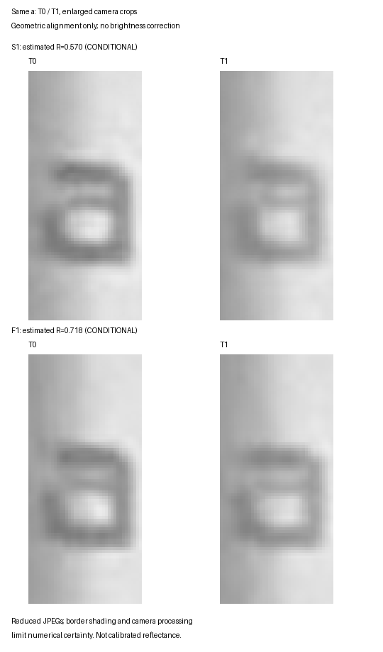

# PaperMono Writer同一文字T0/T1・連続入力検証

Branch: `experiment/papermono-writer-optical`。出発点 `06537cc2`。
診断実装commit: `87be1872`。
前回の結果・Files/UI変更は保持。S1/F1の実機試験とT0/T1撮影は完了。
写真4枚も受領し、同じaの初期黒マスクで相対コントラストを測定した。
推定保持率はS1約57%、F1約72%。ただし影・縮小画像・撮影条件の不確実性があり、判定は **CONDITIONAL**。

## 診断の変更

trialコマンド: `display test display0 writer-quality baseline slow|fast optical`。
以前の6引数の診断はそのまま使える。opticalはbaselineだけを受け付ける。
同じRAM Writer文書・z4/20px・UI140%・R2/800×480・SPI40MHz・tileを使用する。

白と固定参照をOTP cleanupで初期化。開始確認後にaを独立して物理完了まで描画する。
T0は完了から2秒後にready時刻とgenerationを記録し、写真のため停止する。
撮影を確認して次へ進むと、残りbcdefghijを途中のoperator停止なしで入力する。
Slowは毎文字の完了待ち、Fastは60ms目標間隔で入力し、最後だけdrainする。
T1も最終完了から2秒後に同じ停止点を置く。撮影・観察の回答を受けてからcleanupする。
S1→F1の自動移行は行わない。各バッチ開始はユーザーの許可を待つ。

## 低負荷監査

opticalのsnapshot識別は入力行の100×22px領域だけのFNVを使用し、重複は解析で拒否する。
固定参照250×30pxと最初のa（10×22px）のnative VLSB範囲だけで、差分と00/11保持を確認する。
全画面48,000バイトのhash/画素走査をworkerで行わない。
全画面変更画素数・dirty boundsはこのモードでは未測定と明記する。変換や転送の方式は非変更。
observer時間は各回記録し、減ったと仮定せず実機の値で判断する。

T0完了shadowから、論理画素の初期黒マスクを取得する。固定参照とaの各行をMSB-first hexで、終了後のjournalへ出す。
マスク取得はT0の停止中だけであり、b〜jの連続更新に負荷を追加しない。
diagnostic cursor/blink抑制、10submit予約とdriver入口10物理更新上限、正常復帰とfault時の非再試行を継承する。
通常Writer、LUT、VCOM/電圧、executor、本番更新ポリシー、保存・metadata/recoveryは変更しない。

## 撮影手順

1. 横持ち・USB-Cが左側面上寄り。本体とカメラを固定し、画面の四隅が入る位置にする。
2. 照明・露出・ホワイトバランス・フォーカスを固定。可能ならHDR/補正をOFFにする。
3. PCとカメラの時刻を揃える。シャッター時刻またはEXIF日時を保持する。
4. T0/T1の更新完了から2秒後にPCで短い音を鳴らす。合図後に撮影し、遅れの秒数が分かれば記録する。
5. S1-T0/S1-T1、F1-T0/F1-T1を区別して保持する。T0を撮影済みと回答してから連続入力を開始する。

2秒は撮影可能になる時刻であり、実際の撮影時刻を2秒と決めつけない。
PCのpoint受信・cue UTC、deviceのcompleted/ready時刻、gate応答時刻を別々に保持する。
撮影時刻が不明なら経過時間も未測定とする。

## 写真解析

`tests/hil/measure_writer_optical.py`はPillowを使い、EXIF orientation適用後の画面四隅をT0/T1それぞれ指定して位置合わせする。
黒は同じT0マスクの中心画素、白はその周囲から黒の隣接1pxを除いた画素を使用する。
代表輝度のmedianからC=(W-B)/W、R=C1/C0を算出する。
±0.25画素の位置ずれ感度と白領域MAD由来のノイズ代理値も出し、露出・フォーカス等の変動は別に確認する。
代理値は統計的信頼区間ではなく、校正済み反射率・寿命の値でもない。自動でGO判定にはしない。

例: `--analysis S1-analysis.json --t0 S1-T0.jpg --t1 S1-T1.jpg --corners S1-corners.json --output S1-optics.json`。
cornersは`{"T0":[[x,y],...],"T1":[[x,y],...],"camera_conditions":...,"elapsed_after_completion_s":{"T0":...,"T1":...}}`。
四隅の順序は左上→右上→右下→左下。写真の元データは書き換えない。

今回の写真はcorner-onlyの位置合わせでは文字マスクがずれ、aの初期コントラストが非正となったため、その値を採用していない。
`--register-local` で、各ROIに同じT0マスクの正規化相関を使って位置を補正した。
探索は±4論理pixel内、0.5pixelの粗探索→0.125pixelの細探索。探索端に達した結果はエラーで拒否する。
近傍白画素も相関に含め、輝度の絶対値で位置を選ばない。文字の種類や初期黒マスクは変更しない。
全条件・全ROIの補正は範囲内（x −3.5〜−1.625pixel、y −2.625〜−0.375pixel）。
補正後も±0.25pixelの感度を評価した。これはレンズ歪み・撮影処理全体を保証する位置誤差限界ではない。
Exif sub-IFDから撮影日時・露出情報を読み出す処理も追加した。変更はPC解析側のみで、実機firmwareは87be1872のまま。

## 自動検証（実機結果ではない）

- Host回帰137実行PASS。
- 実Writer/raster/SPI両planeのscalar照合、連続Slow/Fast、T0/T1、mask、上限・fault・復帰PASS。
- 低負荷ROI監査を全画面監査と照合し、異常画素の変化も検出した。
- Fastのb〜i中に完了待ちした場合はHostで失敗する。
- Python599件、OK（4skip）。局所位置合わせが既知のずれ・薄まりで同じマスクを追跡すること、探索端・不正条件を検出することも確認。
- 人工写真のファイル読込・画面位置合わせ・相対濃度解析PASS。人工的なaのR=0.75、固定参照R=1を再現した。実機の濃度値ではない。
- trial build 122.70秒、production build 123.48秒、SUCCESS。productionに診断markerがないことをartifactで確認済み。

COM39、ESP32-S3/MAC `28:84:85:44:79:68`、既存application SHA・partition・OTA選択を照合し、
0x10000のota_0 applicationだけを書き込み。written-data verification正常。
NVS/FAT/otadata/PHYは前後の全byteが一致した。
証跡: `.research/writer-optical/flash-20261013-121846/summary.json`。
trial 3,439,760 bytes、SHA256 `586b360b5487d7e2cdb439aa0b2070a46079d1cbfe5a140bfac1ea49c775e840`。
production（未flash）3,426,688 bytes、SHA256 `c15c0ffcaab81bb25afb26d6c5888b5838cc3f982bb0b2166c1436a08f892088`。
両試験は `err=0 healthy=1 restored=1` で終了。事前のRAM dose選択・refresh設定を復元する終了経路を通った。
最後のUSB読出しで `refresh=fastest`・SolarOS 4.16.1 / writerdeckを確認。
ユーザーもShellの文字・白背景が正常と確認した。boot waveformは変更していない。

## 実機・判定

2026-10-13、COM39、同一trialでS1/F1を各1バッチ実施。各開始前にユーザーから許可を受領し、自動で条件を切り替えていない。
白画面・固定参照をOTPで初期化し、最初のaでT0撮影、以後bcdefghijは途中の観察停止なし。
T1撮影・観察の確認後にcleanup。両条件で全10文字を表示し、イベント欠落・overflow・driver errorは0。

| 指標 | S1 Slow | F1 Fast |
|---|---:|---:|
| 入力 / Render / Present要求 | 10 / 10 / 10 | 10 / 10 / 10 |
| 物理更新数 | 10 | 6 |
| aの後続保持更新数 | 9 | 5 |
| pending置換数 | 0 | 4 |
| burst入力間隔の平均 | 162.470ms | 60.463ms |
| burst物理更新間隔の平均 | 162.415ms | 116.714ms |
| b送信〜j表示完了 | 1460.768ms | 629.715ms |
| Driver total p50 | 111.891ms | 114.326ms |
| observer p50 | 0.993ms | 0.991ms |
| observer min–max | 0.984–1.000ms | 0.977–1.030ms |
| aの初回 / 終了時コントラスト（推定） | 0.29584 / 0.16873 | 0.27723 / 0.19900 |
| aの保持率R（推定） | 0.57035 | 0.71784 |
| 固定参照の保持率R（推定） | 0.92923 | 0.93717 |
| 最初のaの目視評価 | T0より薄くなった | T0より薄くなった |

連続入力中の平均にはT0撮影待ちを含めていない。初回a更新→b更新の開始間隔はS1 57.723秒、F1 47.602秒で、撮影・回答・再開の待ち時間に由来する。
その後b〜jの間にoperator gateはない。入力送信→Writer受付は中央値S1 14µs、F1 11µs。
前回約11.7〜11.9msのobserverに対し、今回は約1ms。負荷は低減したが0ではなく、通常Writerと完全に同じ時間特性とは断定しない。

物理表示の履歴（generation:文字数）:

- S1: `3:1, 4:2, 5:3, 6:4, 7:5, 8:6, 9:7, 10:8, 11:9, 12:10`。置換なし。
- F1: `16:1, 17:2, 19:4, 21:6, 23:8, 25:10`。generation `18,20,22,24` はpendingで置換され、物理表示していない。

全物理更新でSPI40MHz、tile、2 RAM plane転送、activation 1回を確認。
固定ROI `[4,37,250,30]` は黒703画素が00、白6797画素が11で保持。
最初のa `[4,147,10,22]` は黒47画素。初回を除く全更新で変更画素0・保持黒00が47、座標不変。
両条件の初期黒マスクも一致している。全画面変更数・boundsは低負荷モードでは未測定と明記し、ROIの不変性と混同しない。

T0/T1の測定可能時刻（PC受信 / 合図、JST。撮影時刻とは別）:

| 条件 | T0 | T1 |
|---|---|---|
| S1 | 12:28:37.630 | 12:29:36.305 |
| F1 | 12:33:27.783 | 12:34:15.521 |

各pointのdevice readyは対応する物理完了の約2秒後。
ユーザーはiPhoneを一定距離で固定して4枚を撮影したと回答。
受領JPEGは1824×1368、Exif orientation 6適用後1368×1824。
会話のresize通知では元画像4032×3024から縮小されている。細い画素の解析に使えたのはこの縮小版である。
4枚のExifは1/60秒、f/1.6、ISO250で一致。ExposureMode / WhiteBalanceは0（auto）だが、これだけでAE/AFロックの有無は判定できない。
フォーカス・WBロック、HDR・自動補正の無効化は未確認。

| 条件 | 添付順T0 / T1 | Exif撮影時刻T0 / T1（JST） | 完了→撮影の推定T0 / T1 |
|---|---|---|---|
| S1 | 2 / 1 | 12:29:19.861 / 12:30:21.702 | 44.23秒 / 47.40秒 |
| F1 | 4 / 3 | 12:33:59.690 / 12:34:53.568 | 33.91秒 / 40.05秒 |

「番号が小さい方が先に撮影」というユーザー説明に加え、Exif日時とaのみ／abcdefghijの画像内容で対応を確認した。
推定経過時間はPC受信時刻・device完成時刻・Exifを対応させた値。iPhoneとPCの時計差は未検証で、厳密なシャッター遅延値ではない。
両写真は十分な停止後に撮影されたが、同一経過時間での比較とはいえず、光学状態の時間変化も交絡候補として残る。

### 光学値の解釈と測定限界

同じ47黒画素のaを追跡した。補正後の黒の代表輝度BはS1 144.0→167.5、F1 146.0→161.0と上昇し、写真上の黒が薄くなる方向。
隣接白の代表輝度WはS1 204.5→201.5（−1.47%）、F1 202.0→201.0（−0.50%）。
背景全体が単純に明るくなっただけでは、このCの低下を説明できない。
固定参照ではWの変化はS1 0%、F1 +0.24%、Cは0.38416→0.35697、0.39192→0.36730だった。

ただしaは左端の影に近い。白119画素の空間MADは22〜23.5/255と大きく、参照領域の2〜2.5/255より大幅にばらつく。
白MAD由来の保守的な代理値はaで0.665 / 0.677。これは影などの空間勾配も含み、時間方向の撮影ノイズや統計的信頼区間そのものではない。
±0.25pixelでaのC範囲はS1 T0 0.251〜0.304 / T1 0.166〜0.185、F1 T0 0.247〜0.282 / T1 0.187〜0.220。
この小さな位置変化だけなら低下方向は一致するが、前記の影・縮小・撮影処理・経過時間まで除外した誤差保証にはならない。
固定参照のC範囲はT0/T1で重なり、約6〜7%の低下を有意な変化とは判定しない。

したがって57% / 72%は今回の写真解析による **探索的な推定値**。
Fastの方が保持率が高い傾向はあるが、差の有意性も回数／間隔の因果効果も断定しない。
校正反射率、実パネルの厳密な43%／28%の濃度損失、寿命・DC安全性の値として扱わない。

図は画面位置合わせ後の同じaの部分画像。明るさ補正は行っていない。図を拡大しても元画像の解像度は増えない。

証跡: [更新履歴JSON](m5paper-mono-writer-optical-results.json)、[指標CSV](m5paper-mono-writer-optical-metrics.csv)。
生USBログ、control、status、回答記録は `.research/writer-optical/` に保持し、BLEログは提出JSONに含めない。

仮説の評価:

- H1: 両条件で同じaの薄まりを目視確認。写真の同じ初期マスクでもC低下を観測したが、全撮影誤差を超えるパネル濃度低下の証明としては条件付き。
- H2: Fastの推定保持率が高い傾向。撮影誤差に加え、回数と間隔が同時に変わるため、有意差やどちらかの因果効果と断定できない。
- H3: 固定参照・最初のaの論理画素不変と保持黒00を実機で確認。
- H4: observer負荷は低減。露出値は一致したが、影・縮小画像・自動処理・撮影時刻に不確実性が残る。

判定は **CONDITIONAL**。GOに必要な「全撮影誤差を除いて再現した」という条件を満たしたとはしない。
一方、同じaの目視・写真のC低下・論理画素不変という複数の証跡が一致するので、NO-GOとも判断しない。

次に原因調査を行う場合の優先候補は **更新回数／間隔の切り分け**。
Fastが6回、Slowが10回となり、同じaの推定保持率にも差の兆候があるため。
ただし実施の前提は、影を避ける撮影角度、原寸ファイル、AE/AF/WB固定、完了→撮影時間統一で測定の弱点を解消すること。
それを整えられない場合は品質実験を一区切りとし、Sketch応答性改善へ移る方が有用。
今回の調査はS1/F1各1バッチで終了し、追加試験・新LUT・本番ポリシー変更・Sketch実装には着手しない。

## 変更ファイル

- `src/apps/solar_os_writer_quality.inc` / `solar_os_writer_quality_trace.h`: trialの連続光学測定、軽量ROI監査、T0/T1、黒マスク出力。
- `tests/hil/capture_writer_quality.py` / `analyze_writer_quality.py`: 撮影合図・gate制御・更新履歴とマスクの検証。
- `tests/hil/measure_writer_optical.py`: 写真の位置合わせ・相対コントラスト・測定感度・Exif。
- `tests/host/writer_quality_test.c`: 実Writer/raster/SPIと安全性のHost検証。
- `tests/test_writer_quality.py` / `test_writer_optical.py`: journal・光学解析の回帰検証。
- 本報告書、results JSON、metrics CSV、同一aの比較PNG: 解析結果と証跡。

保存文書・metadata・checkpoint/recoveryは診断の対象外。RAM専用Writerのまま検証し、通常Writerの入力・保存・UI仕様は変更していない。
写真解析の追加はPC上のPythonのみ。測定後のfirmware再flashは不要で、trial/productionのCコードには追加差分がない。
